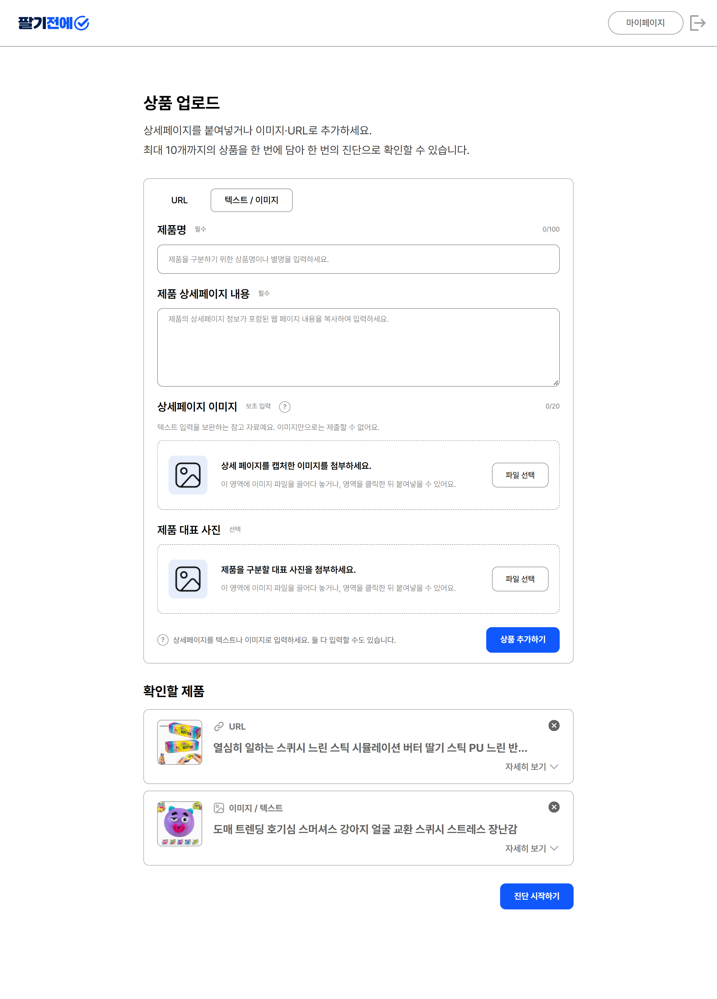
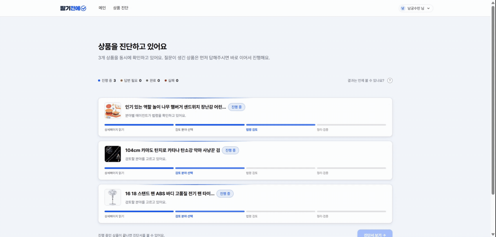
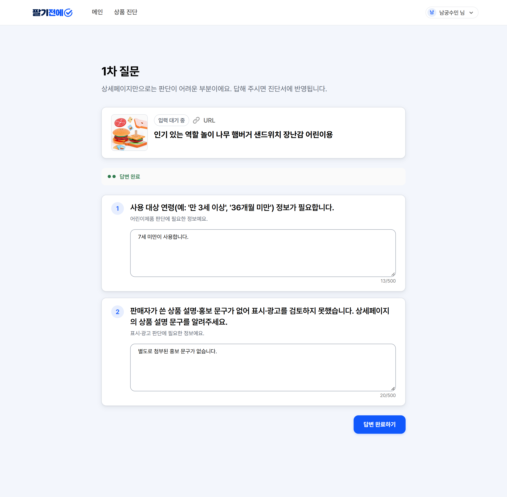
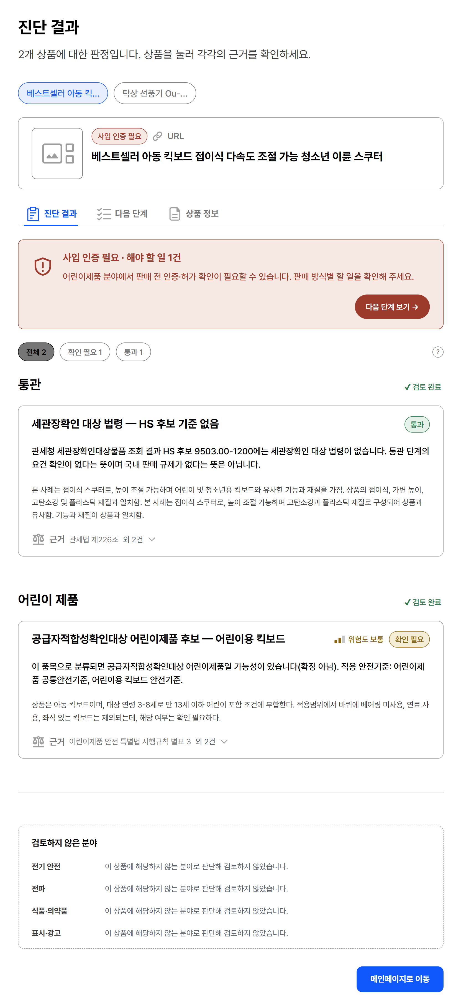
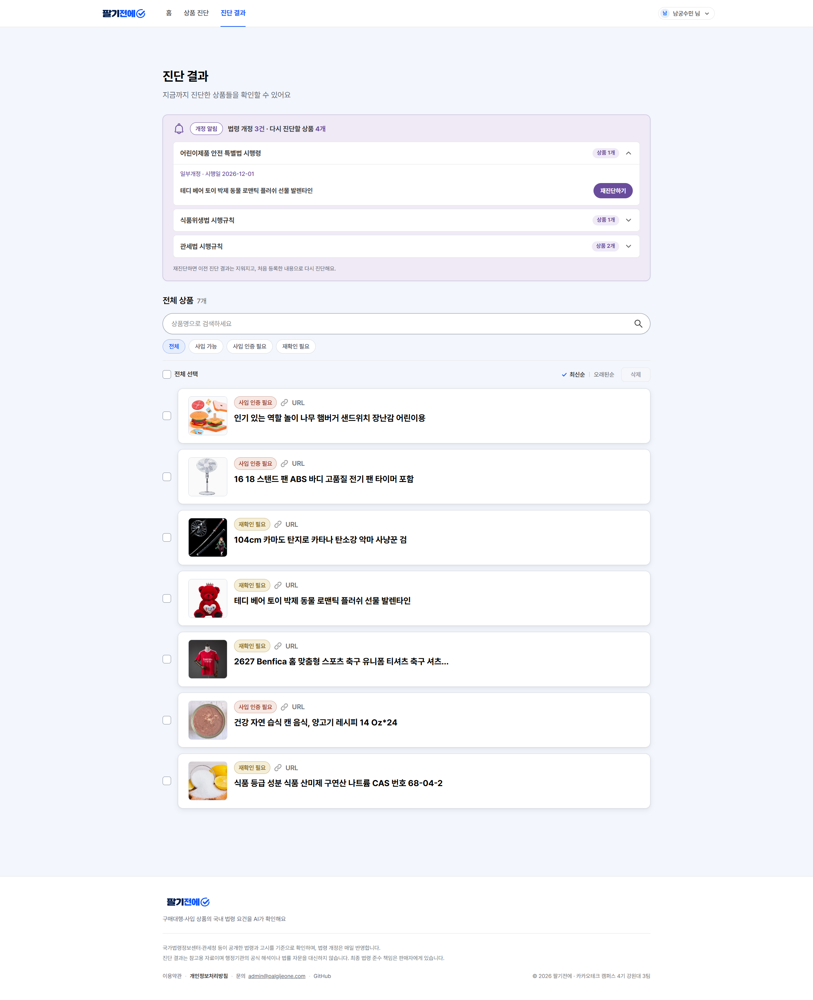
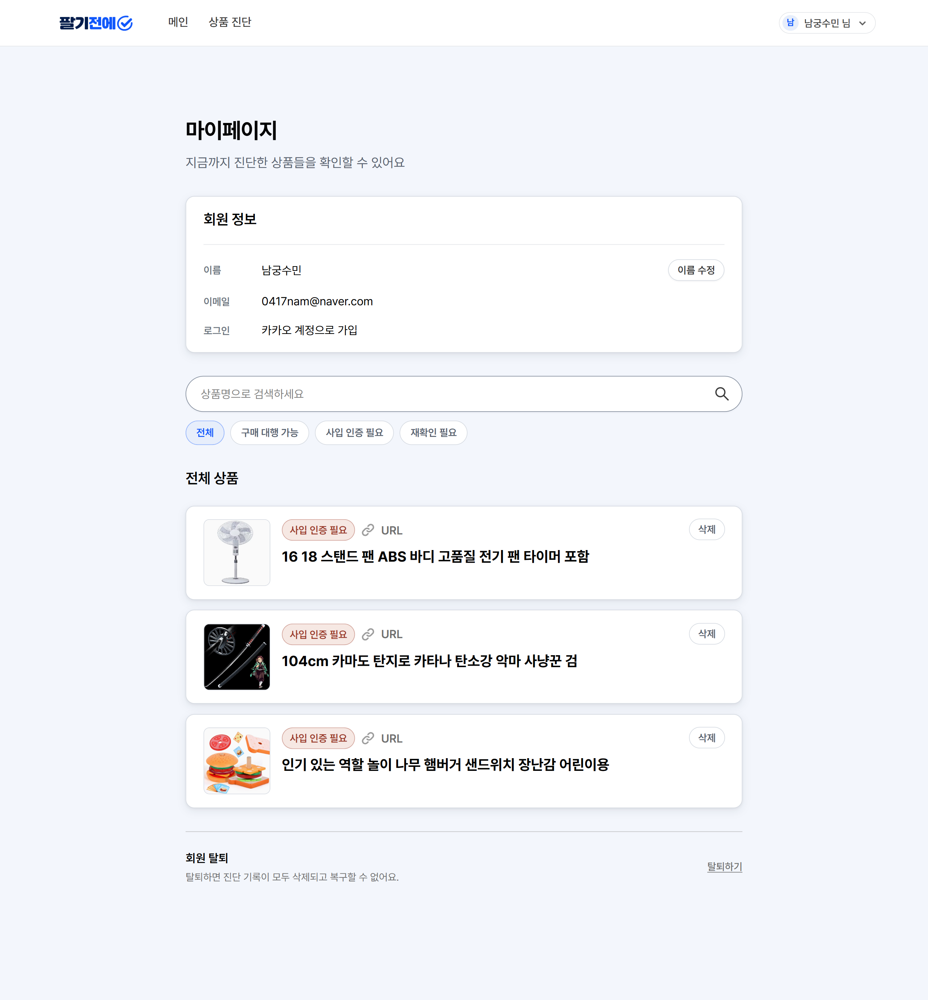
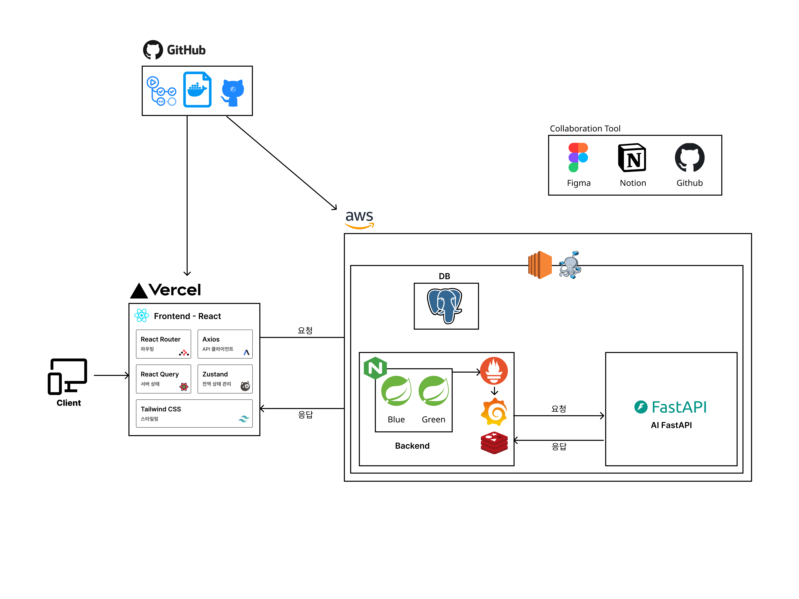

# 팔기전에

해외에서 들여온 상품을 국내에서 팔기 전에, 어떤 인증·규제 대상인지 법령 근거와 함께 진단해 주는 서비스입니다.

- 서비스: https://palgijeone.com
- API 문서(BE): https://palgijeone.com/swagger-ui/index.html
- API 문서(AI) : https://palgijeone.com/docs
- 테크스펙: [위키 테크스펙](https://github.com/kakaotechcampus-4/ktc4-kangwon-3/wiki/테크스펙)

> 진단 결과는 법령 근거에 따른 참고 정보이며 법률 자문이나 확정 판단이 아닙니다.

## 목차

1. [문제 정의](#문제-정의)
2. [타겟 사용자](#타겟-사용자)
3. [핵심 시나리오 예시](#핵심-시나리오-예시)
4. [주요 기능](#주요-기능)
5. [아키텍처](#아키텍처-다이어그램)
6. [기술 스택](#기술-스택)
7. [저장소 구조](#저장소-구조)
8. [빠른 시작](#빠른-시작)
9. [배포와 운영](#배포와-운영)
10. [문서](#문서)
11. [협업](#협업)
12. [팀](#팀)
13. [라이선스](#라이선스)

---

## 문제 정의

해외 상품을 파는 1인 셀러는 자기 상품에 어떤 인증·규제가 걸리는지 판단하기 어렵고, 잘못 판단하면 판매 차단이나 처벌로 이어집니다.

<details>
<summary>어려운 이유와 처벌 사례</summary>

상품 하나에도 KC·전파 인증, 식품·의약품 규제 등 여러 인증과 소관 부처가 걸리고, 구매대행이냐 사입이냐에 따라 의무도 달라집니다(예: 전기용품 구매대행 특례, 전기용품안전관리법 시행규칙 별표 13). 그래서 셀러는 보통 카페 글이나 "남들도 팔던데"로 판단합니다.

- 해외 전자계측기 5개를 판매용으로 들여온 업체가 전파법 적합성평가를 받지 않아 벌금형을 받았습니다. "건전지로 동작하면 면제", "전기용품에서 면제면 전파법도 면제"라는 주장은 받아들여지지 않았고, 판매 전에 인증을 받았어도 처벌됐습니다([대구지방법원 2019고정81](https://casenote.kr/%EB%8C%80%EA%B5%AC%EC%A7%80%EB%B0%A9%EB%B2%95%EC%9B%90/2019%EA%B3%A0%EC%A0%9581)).
- 국내 플랫폼의 해외 구매대행 제품 420개 중 20%가 안전기준에 맞지 않았고(국내 유통제품의 4배), 정부는 KC 인증 없이 어린이제품 등을 판 사업자를 고발하거나 과태료를 부과할 계획입니다(국가기술표준원 조사, [뉴스핌 2026년 5월 14일](https://www.newspim.com/news/view/20260514000136)).

</details>

## 타겟 사용자

법무·인증 담당자 없이, 해외 상품을 스마트스토어·쿠팡 등에 매달 여러 개 등록하는 1인 셀러

## 핵심 시나리오 예시

상품 URL을 넣으면 AI가 규제 분야별로 법령을 검토하고, 정보가 부족하면 셀러에게 물어본 뒤, 판매 방식별 결론·근거 법령·해야 할 일을 진단서로 보여 줍니다. 다음 섹션에서 화면별 실제 흐름을 확인할 수 있습니다.

## 주요 기능
### 1. 진단 요청

상품 URL 또는 글·이미지를 넣습니다. 상품 최대 10개를 한 번에 진단할 수 있습니다.

<table><tr><td>



</td></tr></table>

### 2. 진행 상황

상품별로 상세페이지 읽기 → 검토 분야 선택 → 법령 검토 → 정리·검증 단계를 보여 줍니다. 검토 분야는 AI 에이전트가 6개 분야(통관, 전파, 식품·의약품, 전기용품, 어린이제품, 표시·광고) 중에서 상품에 맞게 고릅니다. 먼저 끝난 상품은 바로 결과를 볼 수 있습니다.

<table><tr><td>



</td></tr></table>

### 3. 추가 질문

판단에 필요한 정보가 상세페이지에 없으면 셀러에게 묻고, 답변을 반영해 다시 진단합니다.

<table><tr><td>



</td></tr></table>

### 4. 진단서

- 결과 상태: 사입 가능 / 사입 인증 필요 / 재확인 필요
- 분야별 판단과 근거 조문 인용(예: 전파법 제58조의2)
- 해야 할 일(예: 판매 전 KC 적합성평가 번호 확인)

<table><tr><td>



</td></tr></table>

### 5. 진단 결과

진단한 상품을 이름으로 검색하고 판정 상태별로 걸러 보며, 누르면 그 상품의 진단 결과로 이동합니다. 법령이 개정되면 영향받는 상품을 알려 주고 다시 진단할 수 있습니다.

<table><tr><td>



</td></tr></table>

### 6. 마이페이지

회원 정보를 확인·수정하고, 법령 개정 알림 수신을 설정하며, 회원 탈퇴를 할 수 있습니다.

<table><tr><td>



</td></tr></table>

---

## 아키텍처 다이어그램

<table><tr><td>



</td></tr></table>

- BE는 AI에 진단을 요청하고 바로 응답을 받습니다(202). 진행 상황과 결과는 AI가 BE로 콜백을 보내 알립니다. FE는 BE를 폴링해 진행 상황을 가져옵니다.

## 기술 스택

| 구분 | 주요 기술 |
|---|---|
| FE |       |
| BE |        |
| AI |       |
| 인프라 |        |

## 저장소 구조

```
.
├── frontend/               # FE
├── backend/                # BE
├── ai/                     # AI
├── infra/                  # nginx, prometheus, grafana
├── e2e/                    # Playwright E2E 테스트
├── loadtest/               # k6 부하테스트
├── docs/                   # 공통 문서
└── .github/                # 워크플로 · 이슈/PR 템플릿
```

## 빠른 시작

- [FE 실행](frontend/README.md#로컬-실행)
- [BE 실행](backend/README.md#로컬-실행)
- [AI 실행](ai/README.md#로컬-실행)

---

## 배포와 운영

| 항목 | 내용 |
|---|---|
| CI/CD | 파트별 GitHub Actions. PR에서는 테스트·빌드를 검사하고, develop에 병합되면 EC2에 자동 배포 |
| 배포 방식 | BE는 Blue-Green 무중단 배포, FE는 릴리스 폴더 교체, AI는 Docker Compose 재기동 후 헬스체크 |
| 모니터링 | Prometheus·Grafana(BE, AI 지표, 호스트·컨테이너 지표), Sentry(FE, BE, AI 에러 수집 및 알림) |
| 부하테스트 | k6로 BE 조회·생성·폴링 부하를 측정 |

자세한 내용은 위키의 [CI/CD와 배포](https://github.com/kakaotechcampus-4/ktc4-kangwon-3/wiki/CI-CD와-배포), [모니터링과 장애 대응](https://github.com/kakaotechcampus-4/ktc4-kangwon-3/wiki/모니터링과-장애-대응)에 있습니다.

## 문서

| 문서 | 내용 |
|---|---|
| [FE README](frontend/README.md) | 화면 구성, 상태 관리, API 연동, 린트 |
| [BE README](backend/README.md) | 도메인, 인증, AI 연동, API, 테스트, 배포 |
| [AI README](ai/README.md) | 에이전트·파이프라인 설계, 품질 평가, 가드레일, 테스트 |
| [E2E](e2e/README.md) | 화면부터 BE·mock-AI까지 잇는 시나리오 12개, 실행 방법 |
| [테크스펙](https://github.com/kakaotechcampus-4/ktc4-kangwon-3/wiki/테크스펙) | 아키텍처, 시나리오, 요구사항·리스크, 인터페이스 명세, 테스트 전략, 지표, 설계 결정 |
| [위키](https://github.com/kakaotechcampus-4/ktc4-kangwon-3/wiki) | 온보딩, 운영 |

## 기여

- 모든 작업은 이슈에서 시작합니다.
- PR을 열면 변경된 경로에 맞춰 파트 리뷰어가 자동으로 지정됩니다.
- 2026-11-10 기준 활동량:
  - PR 379개, 병합된 PR의 99%가 작성자가 아닌 사람의 리뷰를 받아 리뷰 규칙을 준수했습니다.
  - 리뷰 838건(승인 595, 코멘트 210, 변경 요청 32), 코드 라인 코멘트 스레드 174개로 상호 코드 리뷰를 활발히 진행했습니다.
- 기여 규칙은 [CONTRIBUTING.md](CONTRIBUTING.md)을 참조해주세요.

## 팀

| 이름 | 역할 | 담당 |
|---|---|---|
| [이효재](https://github.com/hyotatoFrappuccino) | PM | BE |
| [남궁수민](https://github.com/SumiNK03) | 프론트 리드 | FE |
| [차경호](https://github.com/Homeria) | 백엔드 리드 | BE, AI |
| [이학인](https://github.com/gkrdls) | AI 리드 | AI, BE |
| [임기영](https://github.com/niceome) | 메이커 | BE, FE |
| [윤혜빈](https://github.com/gityhb) | 플래너 | AI |

## 라이선스

[MIT](LICENSE)
