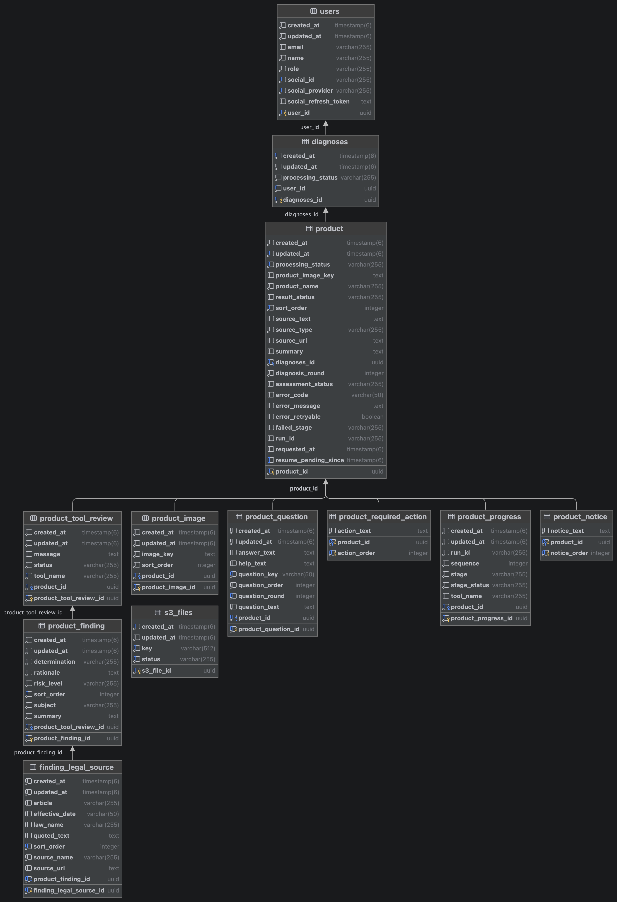

# 팔기전에 BE

로그인, 진단 요청 저장, AI 서버 연동, 진단 결과 제공을 맡는 Spring Boot 서버입니다.

- API 문서(Swagger): https://palgijeone.com/swagger-ui/index.html
- 공통 개발 문서: [위키](../docs/wiki/Home.md)

## 목차

1. [기술 스택](#기술-스택)
2. [프로젝트 구조](#프로젝트-구조)
3. [ERD](#erd)
4. [로컬 실행](#로컬-실행)
5. [테스트](#테스트)
6. [배포와 운영](#배포와-운영)
7. [더 보기](#더-보기)

---

## 기술 스택

| 구분 | 주요 기술 |
|---|---|
| BE |        |
| 인프라 |        |

## 프로젝트 구조

```
kakaotech.kangwon3.beforeselling
├── domains/            # 도메인마다 presentation · application · domain 3계층
│   ├── auth/           # 소셜 로그인(카카오·네이버·구글), 토큰 재발급, 로그아웃
│   ├── user/           # 내 정보 조회·수정, 개정 알림 설정, 회원 탈퇴(진단서 삭제, 토큰 폐기, 소셜 연결 해제)
│   ├── diagnoses/      # 진단서·상품 생성·조회·삭제, 질문 답변, 재시도, 재진단, AI 콜백 수신
│   │   ├── presentation/   # api(Swagger 명세 인터페이스), controller
│   │   ├── application/    # dto, usecase, mapper, event, scheduler
│   │   └── domain/         # entity, repository, service
│   └── lawamendment/   # AI 개정 감지 콜백 수신, 재확인 대상 상품 연결, 개정 목록 조회, 알림 메일
└── global/             # 보안(JWT, 내부 토큰), 처리율 제한, S3·AI 연동, 공통 응답·예외
```

## ERD

<details>
<summary>ERD 보기</summary>



</details>

## 로컬 실행

준비: JDK 25, PostgreSQL, Redis, AWS CLI(S3 사용 시 [SSO 로그인](docs/guide/AWS_SSO_GUIDE.md) 참조)

```bash
cd backend/beforeselling
cp .env.example .env              # 환경변수 설정
docker compose up -d db redis     # PostgreSQL 5432, Redis 6379 (호스트 연결 시 생략)
aws sso login                     # S3 사용 시
set -a; source .env; set +a
./gradlew bootRun                 # 기본 프로필 local, 8080
```

- Swagger: http://localhost:8080/swagger-ui/index.html
- 소셜 로그인 : 각 제공자 콘솔에 `http://localhost:8080/login/oauth2/code/{provider}` 를 등록합니다.
- FE 연결: 기본값이 `http://localhost:5173`을 CORS와 로그인 리다이렉트 주소로 허용합니다.
- AI 연결: `AI_BASE_URL=http://localhost:8000`. `INTERNAL_API_TOKEN`이 AI와 같아야 AI의 콜백을 받습니다.
- LLM 호출 없이 연동만 확인하려면 `.env`에 `AI_DIAGNOSE_PATH_PREFIX=/api/ai/v1/dummy`를 넣습니다. AI 서버는 띄워야 하고, 정해진 케이스로 콜백이 옵니다.
- DB 스키마: `local`은 Hibernate가 스키마를 자동으로 맞춥니다(`ddl-auto: update`). 운영에 반영하려면 Flyway 마이그레이션이 필요합니다([배포와 운영](#배포와-운영)).

## 테스트

```bash
./gradlew test               # 단위
./gradlew integrationTest    # 통합(@Tag("integration"))
./gradlew build              # 단위·통합, 커버리지 리포트와 최소 기준 검사 (PR·develop push마다 CI)
```

| 종류 | 검증 대상 |
|---|---|
| 단위 | 엔티티 상태 전이, 서비스, 유스케이스, 처리율 제한 |
| 통합 | 슬라이스(`@WebMvcTest`, `@DataJpaTest`, `@JsonTest`)와 `@SpringBootTest`. 답변 → 재진단, 재시도, 동시 요청 흐름 |
| E2E | FE와 함께 띄워 사용자 흐름 검증: [`e2e/`](../e2e/README.md) |

| 커버리지(JaCoCo) | 라인 | 브랜치 | 최소 기준 |
|---|---|---|---|
| 단위 (도메인·애플리케이션 계층) | 96.7% | 94.7% | 90% / 90% |
| 단위 + 통합 합산 | 87.7% | 85.8% | 85% / 80% |

2026-11-05 기준

- 커버리지가 최소 기준에 못 미치면 빌드가 실패하고 배포도 막힙니다. 긴급 배포가 필요하면 Actions에서 `Backend CI/CD`를 수동 실행하고 `skip-coverage`를 켭니다.
- 테스트 종류 선택 기준, 작성 규칙, 커버리지는 [BE 테스트 정책](docs/TEST_POLICY.md)에 있습니다. 파트 공통 도구는 위키 [테스트 가이드](../docs/wiki/테스트-가이드.md#be)에 있습니다.

## 배포와 운영

- develop에 병합되면 [`backend.yml`](../.github/workflows/backend.yml)이 빌드 → ECR → EC2 Blue-Green 배포 → API 응답 확인까지 합니다. 절차와 롤백: [`deploy/README.md`](beforeselling/deploy/README.md)
- 프로필: `local`(기본), `prod`, `test`(H2)
- DB 스키마: Flyway로 관리합니다(`src/main/resources/db/migration`). 운영은 `ddl-auto: validate`라, 스키마를 바꾸는 PR은 마이그레이션 SQL을 함께 올립니다. 작성 방법: [Flyway 마이그레이션 가이드](docs/guide/FLYWAY_MIGRATION_GUIDE.md)
- 모니터링: Grafana(응답시간·에러율·JVM), Sentry(5xx, 새 이슈는 Discord 알림). 위키 [모니터링과 장애 대응](../docs/wiki/모니터링과-장애-대응.md)

## 더 보기

- 코드 컨벤션: [`docs/CODE_CONVENTION.md`](docs/CODE_CONVENTION.md)
- 테스트 정책: [`docs/TEST_POLICY.md`](docs/TEST_POLICY.md)
- DB 마이그레이션: [`docs/guide/FLYWAY_MIGRATION_GUIDE.md`](docs/guide/FLYWAY_MIGRATION_GUIDE.md)
- 상태 관리·인증 설계: 테크스펙 [아키텍처 설계](../docs/wiki/테크스펙.md#be-진단-상태-관리)
- 장애 대응: 테크스펙 [BE 장애 대응](../docs/wiki/테크스펙.md#be-장애-대응)
- 설계 결정과 이유: 테크스펙 [트레이드오프](../docs/wiki/테크스펙.md#트레이드오프)
