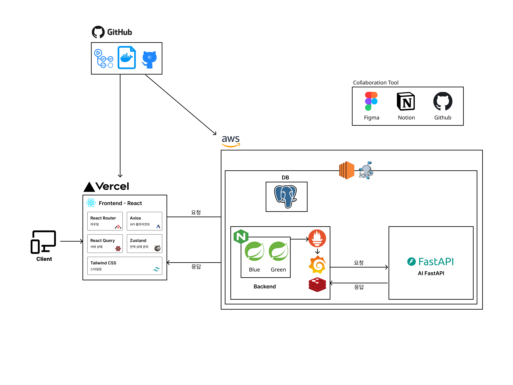
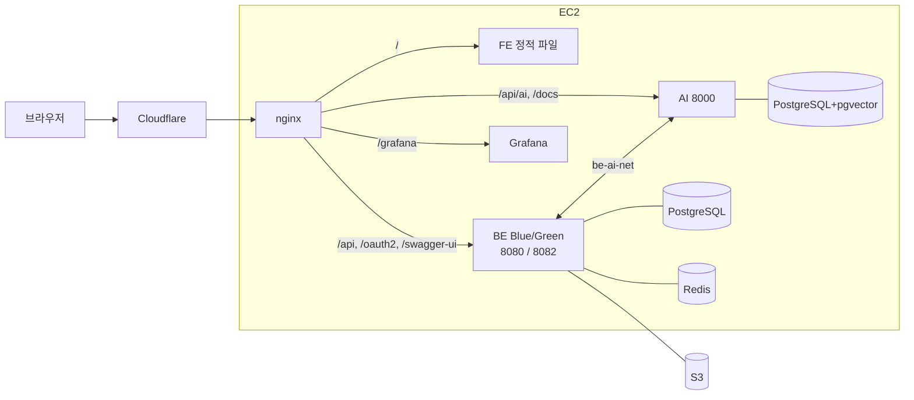
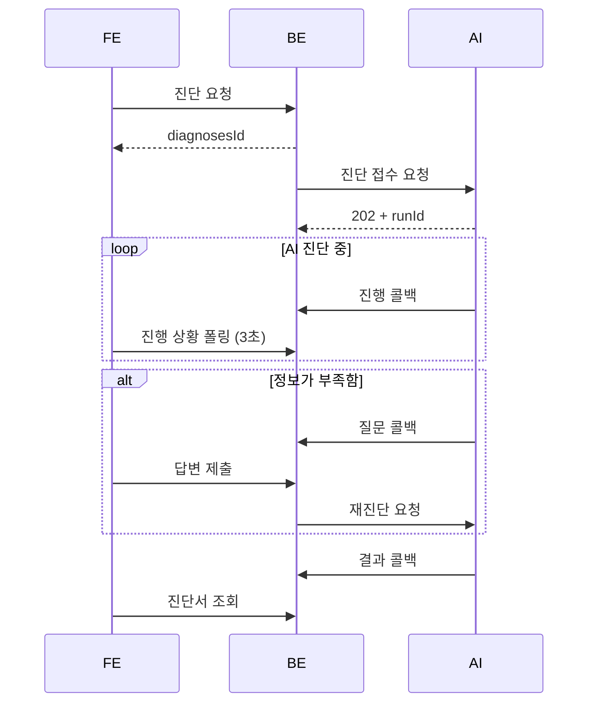
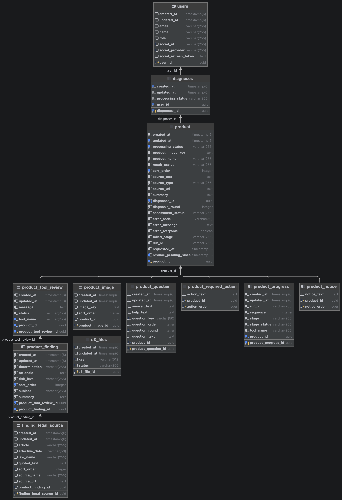

# 테크스펙
```
노션에 작성할 테크스펙입니다.
해당 문서에 먼저 작성하되, 노션에서도 깨지지 않도록 문서 링크를 걸지 않고 단독으로 서술합니다.
```

```
참고 : 평가기준
제공된 테크스펙 템플릿을 작성해 제출합니다. 아래 섹션이 특히 기술 평가의 근거가 됩니다.
• 아키텍처 설계 → 전체 구조·흐름, 에이전트 설계(단계·도구·상태·예외), 기술 스택·배포 구성
• 시나리오 → 사용자 관점의 흐름·주요 동작
• 요구사항 · 리스크 → 가드레일·예외 처리·장애 대응 등 안정성
• 테스트 전략 → 코드 테스트(유닛·통합)와 AI 응답 품질 점검
• 추가 지표 → AI 품질 평가에 쓸 수집 값
• 인터페이스 명세 → API 요청/응답 스펙
```

| 항목 | 링크 |
|---|---|
| 서비스 | https://palgijeone.com |
| 저장소 | https://github.com/kakaotechcampus-4/ktc4-kangwon-3 |
| API 문서 | [BE](https://palgijeone.com/swagger-ui/index.html), [AI](https://palgijeone.com/docs) |
| 파트 README | [FE](https://github.com/kakaotechcampus-4/ktc4-kangwon-3/blob/develop/frontend/README.md), [BE](https://github.com/kakaotechcampus-4/ktc4-kangwon-3/blob/develop/backend/README.md), [AI](https://github.com/kakaotechcampus-4/ktc4-kangwon-3/blob/develop/ai/README.md) |

## 목차

1. [배경과 목표](#배경과-목표)
2. [일정](#일정)
3. [담당](#담당)
4. [요구사항](#요구사항)
5. [아키텍처 설계](#아키텍처-설계)
6. [인터페이스 명세](#인터페이스-명세)
7. [리스크와 대응](#리스크와-대응)
8. [요청사항](#요청사항)
9. [시나리오](#시나리오)
10. [트레이드오프](#트레이드오프)
11. [테스트 전략](#테스트-전략)
12. [스펙 아웃](#스펙-아웃)
13. [추가 지표](#추가-지표)
14. [참고 문서](#참고-문서)

---

## 배경과 목표

### 배경

#### 문제 정의

해외 상품을 파는 1인 셀러는 자기 상품에 어떤 인증·규제가 걸리는지 판단하기 어렵고, 잘못 판단하면 판매 차단이나 처벌로 이어집니다.

상품 하나에도 KC·전파 인증, 식품·의약품 규제 등 여러 인증과 소관 부처가 걸리고, 구매대행이냐 사입이냐에 따라 의무도 달라집니다(예: 전기용품 구매대행 특례, 전기용품안전관리법 시행규칙 별표 13). 그래서 셀러는 보통 카페 글이나 "남들도 팔던데"로 판단합니다.

#### 처벌 사례

- 해외 전자계측기 5개를 판매용으로 들여온 업체가 전파법 적합성평가를 받지 않아 벌금형을 받았습니다. "건전지로 동작하면 면제", "전기용품에서 면제면 전파법도 면제"라는 주장은 받아들여지지 않았고, 판매 전에 인증을 받았어도 처벌됐습니다([대구지방법원 2019고정81](https://casenote.kr/%EB%8C%80%EA%B5%AC%EC%A7%80%EB%B0%A9%EB%B2%95%EC%9B%90/2019%EA%B3%A0%EC%A0%9581)).
- 국내 플랫폼의 해외 구매대행 제품 420개 중 20%가 안전기준에 맞지 않았고(국내 유통제품의 4배), 정부는 KC 인증 없이 어린이제품 등을 판 사업자를 고발하거나 과태료를 부과할 계획입니다(국가기술표준원 조사, [뉴스핌 2026년 5월 14일](https://www.newspim.com/news/view/20260514000136)).

#### 타겟 사용자

법무·인증 담당자 없이, 해외 상품을 스마트스토어·쿠팡 등에 매달 여러 개 등록하는 1인 셀러

### 목표

- 상품 URL·글·이미지를 넣으면, 사람이 끼어들지 않아도 규제 분야별 대상 여부·근거 조문·해야 할 일이 담긴 진단서를 받는다. 정보가 부족하면 셀러에게 필요한 것만 물어보고 이어서 진단한다.
- 같은 상품이라도 판매 방식(구매대행·사입)에 따라 결론이 달라지므로, 판매 방식별 결론을 따로 보여 준다.
- 틀린 "괜찮다" 안내를 최소화한다. 판단할 근거가 없으면 "해당 없음"이 아니라 "재확인 필요"로 안내한다.
- 정보가 부족한 선량한 셀러의 위반을 판매 전에 막아, 소비자 안전을 지키고 사후 단속에 드는 공공 비용을 줄인다. 악의적 위반자는 서비스 대상이 아니다.

### 범위

| 구분 | 범위 |
|---|---|
| 입력 | 상품 URL, 글, 이미지. 한 번에 최대 10개 |
| 규제 분야 | 통관(세관장확인), 전파, 식품·의약품, 전기용품, 어린이제품, 표시·광고 |
| 판매 방식 | 구매대행, 사입 |
| 결과 | 구매대행 가능 / 사입 시 인증 필요 / 재확인 필요, 분야별 판단, 근거 조문, 해야 할 일 |
| 범위 밖 | 화학제품, 식물 검역, 총포 등은 판단하지 않고 "재확인 필요"로 안내 |

---

## 일정


| 주차 | FE | BE | AI |
|---|---|---|---|
| 1~3주차 | 서비스 기획 | 서비스 기획 | 서비스 기획 |
| 4주차 | FE-BE API 스펙 협의<br>와이어프레임 작성, 피그마 설계 | 엔티티 구조 설계<br>FE-BE·BE-AI API 스펙 협의<br>프로젝트 초기 세팅 | BE-AI API 스펙 협의<br>에이전트·스키마 구조 설계 |
| 5주차 | 프로젝트 초기 세팅, CI/CD 구현<br>메인 화면 및 라우팅 구조 구현 | 공통 응답·예외 처리 구조 구현<br>소셜 로그인 구현<br>CI/CD 구현<br>API 문서화 | AI 서버 기본 구조 구축<br>추출 에이전트 구현 |
| 6주차 | 소셜 로그인 구현<br>상품 입력 화면 구현 | 진단서 API 구현<br>파일 업로드(Presigned URL) 구현<br>토큰 재발급 안정화 | 검증 에이전트 구현<br>선택 에이전트 구현 |
| 7주차 | 진단 진행 상황 화면 구현 | 업로드 파일 정리 로직 구현<br>응답 코드·권한 정책 정리<br>엔티티 식별자 리팩토링<br>배포 설정 정비 | AI 서버 CI/CD 구현<br>진단 파이프라인 구현<br>공공 API 클라이언트 구현<br>추출 품질 평가 기준 수립 |
| 8주차 | 상품 입력 BE 연동 | 진단서·상품 도메인 분리<br>모니터링 구성<br>메일 발송 구현 | AI DB 스키마 구현<br>검증 결과 기반 조건부 분기<br>법령 별표 파싱<br>선택 에이전트 평가셋 구축 |
| 9주차 | 마이페이지 구현<br>질문 화면 구현 | 에러 모니터링 연동<br>상품 진단 상태 관리 구현 | 재실행 루프 구현<br>프롬프트 과적합 점검<br>벡터 검색·LLM 호출 안정화 |
| 10주차 | 코드 리뷰 반영 및 리팩토링 | 무중단 배포 구축<br>BE-AI 내부 인증 구현 | 비동기 진단 실행 구조 구축<br>조기 종료 로직 구현<br>규제 Tool 구현(전기용품) |
| 11주차 | 접근성 개선 | AI 콜백 연동(진행·질문·결과·실패)<br>진행 상황 조회(숏폴링) 구현<br>재진단 API 구현<br>중단된 진단 정리 스케줄러 구현 | 콜백 전송 구조 구현<br>재진단 API 구현<br>상품 URL 수집 구현<br>규제 Tool 구현(어린이제품·표시광고)<br>토큰·비용 기록 |
| 12주차 | 진단서 결과 화면 구현 | AI 요청 실패 처리<br>부하 테스트<br>배포 환경변수 관리 개선 | 규제 Tool 구현(전파·통관·식품의약품)<br>추출 품질 개선<br>예외 처리 체계 정리 |
| 13주차 | 진행 화면 고도화(여러 상품 동시 진행)<br>질문 답변 흐름 고도화<br>실제 API 연동<br>요청 한도 초과 처리<br>E2E 테스트 | 재시도 기능 구현<br>처리율 제한<br>배포 파이프라인 개선<br>테스트 커버리지 측정<br>회원 정보 API 구현<br>E2E 테스트 | 진단 파이프라인 통합<br>결과 상태 규칙 구현<br>판단 선택 에이전트 구현<br>공공 데이터 캐시·법령 점검 스케줄러<br>Tool 병렬 실행<br>모니터링 지표 구성<br>오답 분석 및 수정 |
| 14주차 | 회원 정보 화면 구현<br>에러 모니터링 연동<br>서비스 소개 페이지<br>최종 QA, 최종 배포 | DB 마이그레이션 도구 도입<br>테스트 커버리지 기준 적용<br>최종 QA, 최종 배포 | 가드레일 구축<br>배포 중 진단 유지(drain·세션 복원)<br>모니터링 연동<br>최종 QA, 최종 배포 |

---

## 담당

| 이름 | 팀 역할 | 프로젝트 역할 |
|---|---|---|
| 이효재 | PM | BE |
| 남궁수민 | 프론트 리드 | FE |
| 차경호 | 백엔드 리드 | BE, AI |
| 이학인 | AI 리드 | AI, BE |
| 임기영 | 메이커 | BE, FE |
| 윤혜빈 | 플래너 | AI |

---

## 요구사항

### 기능 요구사항

| ID | 요구사항 | 담당 | 상태 |
|---|---|---|---|
| F1 | 소셜 로그인, 로그아웃, 회원 탈퇴 | FE, BE | 완료 |
| F2 | URL·글·이미지로 상품 최대 10개 진단 요청 | FE, BE, AI | 완료 |
| F3 | 상품 정보 추출과 검토 분야 선택 | AI | 완료 |
| F4 | 6개 분야별 대상 여부 판단과 근거 조문 첨부 | AI | 완료 |
| F5 | 검증 후 Tool 재실행·질문·종료 결정 | AI | 완료 |
| F6 | 상품별 진행 상황 표시 | FE, BE | 완료 |
| F7 | 추가 질문과 답변 반영 재진단(최대 2회) | FE, BE, AI | 완료 |
| F8 | 진단서: 결과 상태, 분야별 판단, 근거, 해야 할 일 | FE, BE, AI | 완료 |
| F9 | 실패 상품 재시도 | FE, BE | 완료 |
| F10 | 마이페이지: 과거 진단 조회·삭제 | FE, BE | 완료 |

<!-- TODO: 확인 필요 - 상태 값과 누락된 요구사항 확인 -->

### 비기능 요구사항

| 항목 | 요구사항 | 지금 상태 |
|---|---|---|
| 정확성 | 판매자가 틀린 안내를 받는 오답을 최소화. 모르면 "재확인 필요" | [AI 품질](#ai-품질) |
| 성능 | 진단 1건 응답 시간, 동시 진단 처리 | [성능과 비용](#성능과-비용) |
| 비용 | 진단 1건 모델 비용 | [성능과 비용](#성능과-비용) |
| 가용성 | 배포 중 중단 없음, 외부 장애가 진단 전체를 멈추지 않음 | [리스크와 대응](#리스크와-대응) |
| 보안 | 내부 API 비공개, 토큰 보호, 남의 리소스 비노출 | [인증](#인증) |
| 확장성 | 새 규제 분야를 Tool 하나 추가로 붙임 | [AI README – 규제 Tool](https://github.com/kakaotechcampus-4/ktc4-kangwon-3/blob/develop/ai/README.md#규제-tool) |

<!-- TODO: 확인 필요 - 각 항목의 목표 수치 -->

---

## 아키텍처 설계

### 전체 구성



| 구성 요소 | 기술 | 위치 | 역할 |
|---|---|---|---|
| FE | React, Vite | [`frontend/palgijeonae`](https://github.com/kakaotechcampus-4/ktc4-kangwon-3/tree/develop/frontend/palgijeonae) | 상품 입력, 진행 상황, 진단서 화면 |
| BE | Spring Boot | [`backend/beforeselling`](https://github.com/kakaotechcampus-4/ktc4-kangwon-3/tree/develop/backend/beforeselling) | 로그인, 진단 저장, AI 연동, 결과 제공 |
| AI | FastAPI, LangChain | [`ai`](https://github.com/kakaotechcampus-4/ktc4-kangwon-3/tree/develop/ai) | 상품 정보 추출, 규제 판단, 검증 |
| nginx | - | [`infra/nginx`](https://github.com/kakaotechcampus-4/ktc4-kangwon-3/tree/develop/infra/nginx) | 경로별 라우팅 |
| 모니터링 | Prometheus, Grafana | [`infra/monitoring`](https://github.com/kakaotechcampus-4/ktc4-kangwon-3/tree/develop/infra/monitoring) | 지표 수집과 대시보드 |

### 배포 구조

모든 구성 요소가 AWS EC2 한 대에서 돌아갑니다. Cloudflare를 거쳐 nginx로 들어옵니다.



- BE와 AI는 `be-ai-net` Docker 네트워크로 직접 통신합니다. AI가 BE로 보내는 콜백 경로(`/internal/**`)는 nginx가 외부에 열지 않습니다.
- 이미지는 브라우저가 S3에 직접 올리고, BE는 S3 key만 저장합니다.
- 배포 절차: [CI/CD와 배포](CI-CD와-배포.md)

### 진단 한 건의 흐름



1. FE가 BE에 진단을 요청하면 BE는 저장 후 바로 `diagnosesId`를 돌려줍니다.
2. BE는 커밋 뒤 비동기로 AI에 진단을 요청하고, AI는 즉시 202로 받습니다.
3. AI는 진행·질문·결과·실패를 BE로 콜백합니다. FE는 BE를 폴링해 상태를 가져옵니다.
4. AI가 질문하면 FE에서 답을 받아 BE를 거쳐 AI에 재진단을 요청합니다.

### AI 에이전트 설계

추출 → 선택 → 규제 Tool → 집계 → 검증 순서로 진행하고, 검증 결과에 따라 에이전트가 다음 행동을 스스로 정합니다. 단계별 설계, Tool 6개, 프롬프트 구성은 [AI README – 진단 흐름](https://github.com/kakaotechcampus-4/ktc4-kangwon-3/blob/develop/ai/README.md#진단-흐름)에 있습니다.

| 검증 결과 | 다음 행동 | 상한 |
|---|---|---|
| 통과 | 진단 완료 | - |
| 근거 부족·분야 누락 | 지적된 Tool만 재실행 후 재검증 | 3회. 앞 회차와 결과가 같으면 중단 |
| 상품 정보 부족 | 판매자에게 질문, 답변 수신 후 선택 단계부터 재실행 | 2회차 |
| 수정 불가 | 재확인 필요로 종료 | - |

<!-- TODO: 확인 필요 - AI 파트가 테크스펙에 따로 남길 내용(모델 선택 이유, Tool 단위로 나눈 이유 등) -->

### BE 진단 상태 관리

BE는 상품별 진단 상태를 저장하고 AI 콜백으로 갱신합니다.

- 진단서 상태는 상품 상태로 계산합니다. 답변 대기 상품이 있으면 `AWAITING_INPUT`, 진행 중이 있으면 `IN_PROGRESS`, 모두 실패면 `FAILED`, 나머지는 `COMPLETED`입니다.
- AI 요청은 트랜잭션이 커밋된 뒤 비동기로 보냅니다. AI가 202를 주자마자 콜백을 보내기 때문입니다.
- 콜백은 진단서 행을 잠그고 처리합니다. runId가 현재 실행과 다르면 반영하지 않고, 진행 이벤트는 `sequence`로 순서를 맞추며, 같은 결과·실패 이벤트가 두 번 오면 무시합니다.
- 질문에 답하면 AI에 재진단을, 재시도 가능한 실패 상품은 다시 진단을 요청합니다.

<!-- TODO: 확인 필요 - 상품 상태 전이 다이어그램 -->

### 인증

- 소셜 로그인(카카오·네이버·구글)만 지원합니다.
- AT는 응답 본문(30분), RT는 HttpOnly 쿠키(14일)로 줍니다. RT는 재발급마다 바꾸고, Redis `GETDEL`로 같은 RT의 동시 재발급을 하나만 통과시킵니다.
- 로그인 후 돌아갈 `redirect_uri`는 허용 목록만 받습니다.
- AI 콜백(`/internal/**`)은 `X-Internal-Token`으로 인증하고, nginx가 외부에 열지 않습니다.

### 데이터 모델



| DB | 내용 | 문서 |
|---|---|---|
| BE PostgreSQL | 사용자, 진단서, 상품, 업로드 파일 | [ERD](https://github.com/kakaotechcampus-4/ktc4-kangwon-3/blob/develop/backend/docs/images/erd.png) |
| BE Redis | RT, OAuth2 인가 요청, 처리율 제한 카운터 | - |
| AI PostgreSQL+pgvector | 법령·별표 원문 캐시, 결정사례 벡터 | [DB_CACHE.md](https://github.com/kakaotechcampus-4/ktc4-kangwon-3/blob/develop/ai/docs/DB_CACHE.md) |

BE 스키마는 Flyway 마이그레이션으로 관리합니다. 운영은 `ddl-auto: validate`라 엔티티와 스키마가 다르면 기동하지 않습니다([Flyway 마이그레이션 가이드](https://github.com/kakaotechcampus-4/ktc4-kangwon-3/blob/develop/backend/docs/guide/FLYWAY_MIGRATION_GUIDE.md)).

#### 테이블 관계

- 사용자 1 : 진단서 N, 진단서 1 : 상품 N(한 번에 최대 10개)
- 상품 아래에 진행 상태(`product_progress`), 추가 질문(`product_question`), 분야별 검토(`product_tool_review`) → 판단(`product_finding`) → 근거 조문(`finding_legal_source`)이 붙습니다.
- 해야 할 일과 안내 문구는 `product_required_action`, `product_notice`에 순서대로 저장합니다.
- 업로드 파일은 `s3_files`에서 진단과 따로 관리합니다.

#### 설계 의도가 담긴 필드

| 테이블 | 필드 | 뜻 |
|---|---|---|
| `diagnoses` | `processing_status` | 상품 상태로 계산. 답변 대기 상품이 하나라도 있으면 답변 대기, 진행 중이 있으면 진행 중, 전부 실패해야 실패. 일부 실패는 상품 단위로 표시 |
| `product` | `processing_status` | `PENDING` → `IN_PROGRESS` → `AWAITING_INPUT` / `COMPLETED` / `FAILED` |
| `product` | `run_id` | AI 실행 식별자. 진단·재진단 요청의 202 응답으로 받고, 받기 전에는 null |
| `product` | `requested_at`, `resume_pending_since` | 마지막으로 진단을 요청한 시각, 재진단 요청이 AI에 닿지 않아 다시 보내길 기다린 시작 시각. 재요청 기한의 기준 |
| `product` | `failed_stage`, `error_code`, `error_message`, `error_retryable` | 실패한 단계(추출·선택·Tool 실행·집계·검증·마무리), 실패 코드와 안내 문구, 사용자가 다시 시도할 수 있는지 |
| `product` | `assessment_status` | AI가 진단을 끝까지 마쳤는지(`COMPLETED` / `INCOMPLETE`). 재실행 상한, 진전 없음, 비용 상한 등으로 멈추면 `INCOMPLETE` |
| `product` | `result_status` | 셀러에게 보여 줄 결론(구매대행 가능 / 사입 시 인증 필요 / 재확인 필요). AI가 모델이 아니라 코드 규칙으로 정함 |
| `product_question` | `question_round`, `question_key`, `answer_text` | 질문 회차, 질문 식별 키, 셀러 답변. 답변을 받으면 재진단을 요청 |
| `product_progress` | `stage`, `stage_status`, `tool_name` | 진행 콜백의 단계·Tool별 최신 상태. 진행 화면이 읽음 |
| `product_tool_review` | `status` | 분야별 검토 결과(`COMPLETED` / `SKIPPED` / `INCOMPLETE`). `INCOMPLETE`는 정보 부족이라 실패로 보지 않음 |
| `product_finding` | `determination`, `risk_level` | 대상 여부(필요 / 불필요 / 필요할 수 있음 / 정보 부족 / 해당 없음)와 위험도 |
| `finding_legal_source` | `law_name`, `article`, `quoted_text`, `effective_date`, `source_url` | 판단마다 근거 법령, 조문, 원문 인용, 시행일, 출처를 붙임 |
| `s3_files` | `status` | 업로드 파일 `PENDING` → `CONFIRMED`. 진단에 쓰이지 않은 파일은 스케줄러가 정리 |

---

## 인터페이스 명세

### 필드 이름 규칙

파트 사이에 주고받는 JSON 필드 이름은 **camelCase**로 통일합니다. 파트 내부 코드는 언어별 표준을 그대로 씁니다.

| 구간 | JSON 필드 | 내부 코드 |
|---|---|---|
| FE ↔ BE | camelCase | FE·BE 모두 camelCase |
| BE ↔ AI | camelCase | BE camelCase / AI snake_case |
| AI 내부·LLM 스키마 | - | snake_case |

- 파트 사이에 케이스를 바꿔 주는 변환 DTO는 만들지 않습니다.
- AI에서는 BE와 주고받는 모델만 경계용 베이스(`ApiModel`, `ApiRequestModel`)를 상속합니다([`ai/app/schemas/base.py`](https://github.com/kakaotechcampus-4/ktc4-kangwon-3/blob/develop/ai/app/schemas/base.py)).

### FE ↔ BE

- 전체 명세: [Swagger](https://palgijeone.com/swagger-ui/index.html)
- 공통 응답: `{ code, message, details, data }`
- 인증: `Authorization: Bearer <accessToken>`. 재발급은 RT 쿠키로 `POST /api/v1/auth/reissue`

<!-- TODO: 확인 필요 - 주요 엔드포인트 표(메서드, 경로, 설명). Swagger와 어긋나지 않게 핵심만 -->

### BE ↔ AI

확정 계약은 [`ai/docs/AI_COMMON_CONTRACT.md`](https://github.com/kakaotechcampus-4/ktc4-kangwon-3/blob/develop/ai/docs/AI_COMMON_CONTRACT.md)입니다.

| 방향 | 엔드포인트 | 내용 |
|---|---|---|
| BE → AI | `POST /api/ai/v1/diagnose/content` | 진단 접수. 202와 상품별 `runId` |
| BE → AI | `POST /api/ai/v1/diagnose/resume` | 답변 후 재진단. 새 `runId` |
| AI → BE | `POST /internal/v1/ai/products/{productId}` | 콜백: `product_progress`, `product_awaiting_input`, `product_result`, `product_failed` |

- 인증: 양방향 모두 `X-Internal-Token` 헤더. 두 서버의 `INTERNAL_API_TOKEN`이 같아야 합니다(32자 이상).
- 순서: 진행 콜백은 `sequence`로 순서를 맞춥니다. BE는 현재 `runId`가 아닌 콜백을 반영하지 않습니다.
- 재전송: AI는 5xx·타임아웃이면 콜백을 최대 5회 다시 보냅니다. BE가 잠금 충돌(`COMMON-009`)로 응답해도 다시 보냅니다.

### 에러 코드

```json
{ "code": "COMMON-002", 
  "message": "...", 
  "details": [{ 
    "field": "files", 
    "message": "..."
  }], 
  "data": null
}
```

| 그룹 | 코드 | 상태 | 뜻 |
|---|---|---|---|
| 공통 | `COMMON-001` | 400 | 잘못된 요청 |
| | `COMMON-002` | 400 | 입력값 검증 실패(`details`에 필드별 사유) |
| | `COMMON-003` | 400 | 데이터 무결성 위반 |
| | `COMMON-004` | 401 | 인증 필요 |
| | `COMMON-005` | 403 | 권한 없음 |
| | `COMMON-006` | 404 | 리소스 없음(남의 리소스 포함) |
| | `COMMON-007` | 405 | 지원하지 않는 메서드 |
| | `COMMON-008` | 500 | 서버 오류 |
| | `COMMON-009` | 409 | 잠금 충돌(잠시 후 다시 시도) |
| | `COMMON-010` | 409 | 상태 충돌 |
| | `COMMON-011` | 429 | 요청 한도 초과(`Retry-After` 헤더) |
| 인증 | `AUTH-001` | 401 | AT 만료 → 재발급 |
| | `AUTH-002` | 401 | AT 무효 |
| | `AUTH-003` | 401 | RT 무효 → 다시 로그인 |
| | `AUTH-004` | 401 | 소셜 로그인 실패 |
| | `AUTH-005` | 400 | 지원하지 않는 소셜 제공자 |
| 파일 | `FILE-001` | 400 | 지원하지 않는 확장자 |
| | `FILE-003` | 400 | 파일 크기 초과 |

- 최신 목록: https://palgijeone.com/error-codes
- FE가 해당 코드로 분기해야 할 때만 도메인 코드를 새로 만듭니다.

### 진단 실패 코드

AI 진단이 실패하면 상품에 실패 코드, 안내 문구, 재시도 가능 여부가 저장되고 FE에 전달됩니다.

| 코드 | 낸 곳 | 뜻 | 재시도 |
|---|---|---|---|
| `AI_UNSUPPORTED_SITE` | AI | 지원하지 않는 판매 사이트 | 불가 |
| `AI_SOURCE_FETCH_FAILED` | AI | 상세페이지 수집 실패 | 가능 |
| `AI_EMPTY_SOURCE` | AI | 수집 결과가 비어 있음 | 불가 |
| `AI_PIPELINE_ERROR` | AI | 추출·검증 등 진단 중 오류 | 원인에 따라 다름 |
| `AI_TIMEOUT` | AI | 진단 시간 초과(600초) | 가능 |
| `BE_DIAGNOSES_TIMEOUT` | BE | 15분 동안 진행 소식이 없음 | 가능 |
| `BE_AI_REQUEST_UNAVAILABLE` | BE | AI가 10분 동안 요청을 받지 못함 | 가능 |
| `BE_AI_REQUEST_REJECTED` | BE | AI가 요청을 거절함 | 불가 |
| `BE_AI_RESUME_UNAVAILABLE` | BE | 재진단 요청을 AI에 전달하지 못함 | 가능 |

전체 목록: [`ProductFailureReason`](https://github.com/kakaotechcampus-4/ktc4-kangwon-3/blob/develop/backend/beforeselling/src/main/java/kakaotech/kangwon3/beforeselling/domains/diagnoses/domain/entity/ProductFailureReason.java), [`ai/app/domain/errors.py`](https://github.com/kakaotechcampus-4/ktc4-kangwon-3/blob/develop/ai/app/domain/errors.py)

### 계약을 바꿀 때

1. 이슈를 만들고 두 파트가 함께 논의합니다.
2. `AI_COMMON_CONTRACT.md`(BE↔AI)나 Swagger 명세(FE↔BE)를 먼저 고칩니다.
3. 받는 쪽이 먼저 새 형식을 받을 수 있게 배포한 뒤, 보내는 쪽을 바꿉니다.

---

## 리스크와 대응

| 리스크 | 영향 | 대응 |
|---|---|---|
| 모델이 "문제없음"으로 잘못 판단 | 셀러가 미인증 상품을 판매 | 확정 판단 금지, 결과 상태를 코드 규칙으로 결정([AI 가드레일](#ai-가드레일)) |
| 모델이 없는 조문을 만들어 냄 | 잘못된 근거 안내 | 모델은 후보 ID만 고르고 원문은 코드가 조회해 첨부 |
| 상품 글 속 지시문(프롬프트 인젝션) | 진단 결과 조작 | 입력 확인 + 에이전트 가드레일 2단계 |
| AI 서버 장애, 콜백 유실 | 사용자가 "진행 중"에 갇힘 | 요청 실패 4분류, 스케줄러 정리([BE 장애 대응](#be-장애-대응)) |
| 같은 진단이 두 번 실행 | 비용 낭비, 결과 덮어쓰기 | 받았는지 모르면 재전송하지 않음, runId·sequence 확인 |
| 외부 API(법제처 등) 장애 | 근거 조회 실패 | 법령 원문 DB 캐시, Tool 하나가 실패해도 진단은 계속 |
| Redis 장애 | 처리율 제한이 요청을 막음 | 100ms 안에 응답하지 않으면 통과 |
| 배포 중 장애 | 서비스 중단 | Blue-Green 배포, 옛 버전을 롤백 대상으로 보존 |

<!-- TODO: 확인 필요 - 프로젝트 관리 리스크(일정, 인원)와 법적 리스크(면책 고지) -->

### AI 가드레일

판매자가 잘못된 "문제없음" 판정을 받지 않게 하는 것이 최우선입니다. 적용 방법과 효과는 [AI README – 가드레일](https://github.com/kakaotechcampus-4/ktc4-kangwon-3/blob/develop/ai/README.md#가드레일)에 있습니다.

- 확정 판단 금지: 판단 값에 "인증 불필요·판매 가능"이 없습니다.
- 법령 문구 생성 금지: 원문은 코드가 조회해 그대로 첨부합니다.
- 상품 조건 원문 대조: 인용문이 상품 원문에 실제로 있을 때만 씁니다.
- 결과 상태는 규칙으로 결정합니다([`results/status.py`](https://github.com/kakaotechcampus-4/ktc4-kangwon-3/blob/develop/ai/app/results/status.py)).
- 불확실하면 "재확인 필요"로 표시합니다.

### BE 장애 대응

AI 요청 결과는 네 가지로 나눠 처리합니다([`AiDiagnosesClient`](https://github.com/kakaotechcampus-4/ktc4-kangwon-3/blob/develop/backend/beforeselling/src/main/java/kakaotech/kangwon3/beforeselling/global/infra/ai/AiDiagnosesClient.java)).

| 분류 | 조건 | 처리 |
|---|---|---|
| 받지 못함 | 429, 5xx(501 제외), 연결 실패 | `PENDING`으로 되돌리고 스케줄러가 다시 요청 |
| 알 수 없음 | 읽기 타임아웃, 202 응답 해석 실패 | 중복 진단을 막으려고 다시 보내지 않음. 멈춘 진단 정리에 맡김 |
| 거절 | 그 밖의 4xx, 501 | 재시도 불가로 실패 처리 |
| 충돌 | 409 | 충돌한 상품만 실패 처리하고 나머지는 다시 요청 |

콜백이 끊기거나 요청이 전달되지 않아도 사용자가 "진행 중"에 갇히지 않도록 스케줄러가 정리합니다.

| 스케줄러 | 주기 | 하는 일 |
|---|---|---|
| 멈춘 진단 정리 | 60초 | 15분 동안 상태가 바뀌지 않은 상품을 `BE_DIAGNOSES_TIMEOUT`으로 실패 처리 |
| 진단·재진단 재요청 | 60초 | 전달되지 않은 요청을 다시 보내고, 기한이 지나면 실패 처리 |
| 고아 파일 정리 | 매시 정각 | 24시간 동안 진단에 쓰이지 않은 S3 파일 삭제 |

- 처리율 제한(사용자당 분당 300회, AI 요청은 20회)은 Redis가 100ms 안에 응답하지 않으면 건너뜁니다.
- 장애가 났을 때의 확인 순서: [모니터링과 장애 대응](모니터링과-장애-대응.md)

### 파트별 예외 처리 원칙

| 파트 | 원칙 |
|---|---|
| BE | 예외는 `BaseException(응답 코드)`로 던지고 `GlobalExceptionHandler`가 공통 응답으로 바꿉니다. 남의 리소스는 404. 5xx만 error 로그와 Sentry로 보냅니다 |
| AI | Tool 하나가 실패해도 진단 전체를 멈추지 않습니다. 판단할 수 없으면 "정보 부족", 진단을 끝내지 못하면 "재확인 필요"와 이유를 안내합니다. HTTP 오류 응답에 내부 원인을 담지 않습니다 |
| FE | `AUTH-001`이면 재발급 후 재요청, 그 밖의 401이면 로그인 화면으로 보냅니다. 그 외 에러는 BE 문구(`details[0].message` → `message`)를 보여줍니다 |

## 요청사항

개발 초기에 파트별로 정리한 요청과 그 결정입니다.

| 대상 | 요청 | 결정 |
|---|---|---|
| 공통 | 아키텍처 구조, 기능·비기능 요구사항 검토 | [요구사항](#요구사항)과 [아키텍처 설계](#아키텍처-설계)로 확정 |
| 공통 | 전체 일정 검토 및 수정 | [일정](#일정)대로 진행. 범위에서 뺀 기능은 [스펙 아웃](#스펙-아웃)에 정리 |
| 공통 | 테크스펙 확정 | 이 문서로 확정 |
| AI, BE | BE-AI API 스펙과 책임 범위 | 진단은 비동기(202 + 콜백). BE는 로그인·진단 저장·결과 제공, AI는 상품 정보 추출·규제 판단·검증을 맡음 |
| FE, BE | FE-BE API 스펙 | Swagger와 에러 코드 목록으로 공유. 파트 간 JSON 필드는 camelCase |

---

## 시나리오

### 기본 흐름

1. 셀러가 소셜 로그인 후 상품 URL(또는 글·이미지)을 입력합니다.
2. 진행 화면에서 상품별 단계(상세페이지 읽기 → 검토 분야 선택 → 법령 검토 → 정리·검증)를 봅니다.
3. 진단이 끝나면 진단서에서 판매 방식별 결론, 근거 조문, 해야 할 일을 확인합니다.
4. 나중에 마이페이지에서 과거 진단을 다시 봅니다.

<!-- TODO: 확인 필요 - 단계별 화면 캡처 (FE README 이미지 재사용) -->

### 정보가 부족할 때

1. 검증 단계에서 상품 정보가 부족하다고 판단하면 AI가 질문을 만듭니다(예: "배터리로만 동작하나요?").
2. 셀러가 답하면 선택 단계부터 다시 진단합니다. 질문은 최대 2회차까지입니다.

### 진단이 실패할 때

| 상황 | 사용자에게 보이는 것 | 처리 |
|---|---|---|
| 지원하지 않는 사이트, 수집 실패 | 실패 사유와 재시도 가능 여부 | [진단 실패 코드](#진단-실패-코드) |
| AI 서버가 요청을 받지 못함 | 진행 중 → 재요청 → 기한이 지나면 실패 | [BE 장애 대응](#be-장애-대응) |
| 15분 동안 진행 소식이 없음 | 실패, 재시도 가능 | [BE 장애 대응](#be-장애-대응) |
| 확인하지 못한 분야가 있음 | 결과 상태 "재확인 필요"와 이유 | [AI 가드레일](#ai-가드레일) |

<!-- TODO: 확인 필요 - 실패 화면 캡처 -->

---

## 트레이드오프

중요한 기술 결정과 그 이유입니다. 자세한 논의는 링크한 PR과 이슈에 있습니다.

### 파트 공통

| 결정 | 이유 | 기록 |
|---|---|---|
| 파트 간 JSON은 camelCase, 변환 DTO 없음 | 파트 내부는 언어 표준을 쓰고, 경계에서만 이름 규칙을 맞추기 위해 | [#71](https://github.com/kakaotechcampus-4/ktc4-kangwon-3/issues/71) |
| AI 진단은 비동기(202 + 콜백) | 진단이 상품마다 1~2분 이상 걸려 요청을 붙잡고 있을 수 없음 | [#280](https://github.com/kakaotechcampus-4/ktc4-kangwon-3/pull/280), [#321](https://github.com/kakaotechcampus-4/ktc4-kangwon-3/pull/321) |
| FE는 숏폴링, 간격은 BE가 정함 | 서버 부하와 갱신 주기를 BE 설정 한 곳에서 조정. 진행 중인 상품이 없으면 폴링을 멈춤 | [#366](https://github.com/kakaotechcampus-4/ktc4-kangwon-3/pull/366), [#504](https://github.com/kakaotechcampus-4/ktc4-kangwon-3/pull/504) |
| BE↔AI 내부 토큰 인증, 콜백 경로는 외부 비공개 | 내부 API를 외부에서 호출하지 못하게 함 | [#305](https://github.com/kakaotechcampus-4/ktc4-kangwon-3/pull/305), [#436](https://github.com/kakaotechcampus-4/ktc4-kangwon-3/pull/436) |

### BE

| 결정 | 이유 | 기록 |
|---|---|---|
| AT는 응답 본문, RT는 HttpOnly 쿠키. RT는 재발급마다 교체 | AT는 JS 메모리에만, RT는 스크립트로 읽을 수 없게. 탈취된 RT의 재사용을 막음 | [#17](https://github.com/kakaotechcampus-4/ktc4-kangwon-3/pull/17) |
| 요청마다 DB에서 사용자를 조회하지 않음 | 매 요청 조회 비용을 피함. 탈퇴 후 남은 AT로 요청하면 리소스가 없어 404가 됨(알고 있는 한계) | [#17](https://github.com/kakaotechcampus-4/ktc4-kangwon-3/pull/17) |
| 남의 리소스는 404 | 리소스가 있는지조차 알려주지 않기 위해 | [#150](https://github.com/kakaotechcampus-4/ktc4-kangwon-3/pull/150) |
| AI 요청 실패를 받지 못함 / 알 수 없음 / 거절 / 충돌로 나눔 | 받지 못한 것만 다시 보내고, 받았는지 모르면 중복 진단을 막으려고 다시 보내지 않음 | [#387](https://github.com/kakaotechcampus-4/ktc4-kangwon-3/pull/387), [#457](https://github.com/kakaotechcampus-4/ktc4-kangwon-3/pull/457) |
| 콜백이 끊긴 진단은 스케줄러가 실패 처리 | 사용자가 영원히 "진행 중"을 보지 않게 함 | [#342](https://github.com/kakaotechcampus-4/ktc4-kangwon-3/pull/342) |
| 처리율 제한은 Redis가 100ms 안에 응답하지 않으면 통과 | 부가 기능 장애가 핵심 기능을 막지 않게 함 | [#499](https://github.com/kakaotechcampus-4/ktc4-kangwon-3/pull/499) |
| Blue-Green 무중단 배포, 옛 버전은 멈춰 두어 롤백 대상으로 | 배포 중 서비스 중단을 없애고, 바로 되돌릴 수 있게 함 | [#298](https://github.com/kakaotechcampus-4/ktc4-kangwon-3/pull/298) |
| 업로드 파일을 PENDING → CONFIRMED로 관리하고 고아 파일 정리 | 진단에 쓰이지 않은 업로드 파일이 쌓이지 않게 함 | [#125](https://github.com/kakaotechcampus-4/ktc4-kangwon-3/pull/125) |
| 스키마는 Flyway로 관리하고 운영은 `ddl-auto: validate` | Hibernate 자동 변경은 컬럼 삭제·제약 변경을 반영하지 못하고 이력도 남지 않음. 마이그레이션 누락은 CI의 `FlywayMigrationTest`가 잡음 | [#595](https://github.com/kakaotechcampus-4/ktc4-kangwon-3/pull/595) |
| 커버리지 최소 기준을 CI에서 검사하고, 미달이면 배포도 막음 | 기준을 정의만 하면 지켜지지 않음. 긴급 배포는 수동 실행의 `skip-coverage`로 검사만 건너뜀 | [#610](https://github.com/kakaotechcampus-4/ktc4-kangwon-3/pull/610) |

### AI

| 결정 | 이유 | 기록 |
|---|---|---|
| 검증 에이전트를 두고, 결과에 따라 Tool 재실행·질문·종료로 분기 | 한 번에 끝내지 않고 스스로 보완하게 함. 재실행 상한과 조기 종료로 무한 반복을 막음 | [#64](https://github.com/kakaotechcampus-4/ktc4-kangwon-3/pull/64) |
| 결과 상태는 모델이 아니라 코드 규칙으로 결정 | 같은 판단이면 항상 같은 결과가 나오게 하고, 모델의 과신을 막음 | [`results/status.py`](https://github.com/kakaotechcampus-4/ktc4-kangwon-3/blob/develop/ai/app/results/status.py) |
| 모르면 "해당 없음"이 아니라 "정보 부족" | 놓친 규제를 "괜찮다"로 안내하지 않기 위해 | [Tool 문서](https://github.com/kakaotechcampus-4/ktc4-kangwon-3/tree/develop/ai/docs) |
| 근거 없이 짐작한 false는 코드로 "모름"으로 되돌림 | 프롬프트로 지시해도 모델이 따르지 않아, 기준이 분명한 칸만 코드로 옮김 | [#411](https://github.com/kakaotechcampus-4/ktc4-kangwon-3/pull/411) |
| LLM 호출을 스트리밍으로 | 게이트웨이가 긴 응답을 2,000토큰에서 자름 | [#250](https://github.com/kakaotechcampus-4/ktc4-kangwon-3/pull/250) |
| 결정사례 벡터 검색은 HNSW 인덱스 | 데이터가 적은 표에서 IVFFlat이 결과를 놓침(recall@5 0.49 → 1.00) | [#255](https://github.com/kakaotechcampus-4/ktc4-kangwon-3/pull/255) |
| 콜백은 발신함으로 상품별 순서 보장, 지수 백오프 재전송 | BE가 잠시 응답하지 못해도 이벤트를 잃지 않게 함. 발신함은 메모리라 AI가 강제 종료되면 못 보낸 이벤트는 사라지고, BE 스케줄러가 15분 뒤 실패로 정리 | [#321](https://github.com/kakaotechcampus-4/ktc4-kangwon-3/pull/321) |
| 프롬프트를 바꾸면 평가셋으로 전후 비교 | 모델 응답이 흔들려 감으로는 개선 여부를 알 수 없음 | [EXTRACTION_EVAL.md](https://github.com/kakaotechcampus-4/ktc4-kangwon-3/blob/develop/ai/docs/EXTRACTION_EVAL.md) |

---

## 테스트 전략

### 원칙

- 외부 서비스(LLM, 법제처, 소셜 API, 상대 파트 서버)는 테스트에서 가짜로 바꿉니다. 실제로 부르는 테스트는 따로 표시해 CI에서 빼냅니다.
- 모델 응답의 품질은 단위 테스트가 아니라 평가셋으로 잽니다.
- 버그를 고칠 때는 그 버그를 재현하는 테스트를 먼저 씁니다.

### 파트별 구성

| 파트 | 규모 | 구성 | CI |
|---|---|---|---|
| BE | 테스트 클래스 87개, 실행 케이스 701개 | 단위 58, 슬라이스 14, 통합 13, 수동 2 | PR·develop push마다 `./gradlew build` (커버리지 최소 기준 검사 포함) |
| AI | 테스트 파일 210개, 테스트 함수 2,004개 | 단위, 통합, 외부 API(`external_api` 마커) | PR·develop push마다 `pytest` |
| FE | - | - | lint와 빌드(타입 검사) |
| E2E | 시나리오 12개 | FE → BE → mock-AI를 브라우저로 검증 | develop 대상 PR과 develop 병합 후 `e2e.yml` (배포를 막지 않음) |

<!-- TODO: 확인 필요 - 2026-11-07 기준 수치. 제출 직전에 다시 집계 -->

- BE 통합 테스트는 답변 → 재진단, 재시도, 동시 삭제처럼 여러 단계가 이어지는 흐름을 검증합니다.
- 실행 방법과 작성 규칙: [테스트 가이드](테스트-가이드.md), [BE 테스트 정책](https://github.com/kakaotechcampus-4/ktc4-kangwon-3/blob/develop/backend/docs/TEST_POLICY.md)

### AI 품질 평가

같은 상품을 반복 실행해 사람이 만든 정답표와 비교합니다. 판매자가 틀린 안내를 받게 되는 오답(C1)은 따로 셉니다. 프롬프트나 규칙을 바꾸면 평가를 다시 돌려 전후를 PR에 남깁니다.

| 대상 | 정답표 | 문서 |
|---|---|---|
| 추출 | 상품 23개 | [EXTRACTION_EVAL.md](https://github.com/kakaotechcampus-4/ktc4-kangwon-3/blob/develop/ai/docs/EXTRACTION_EVAL.md) |
| 선택 | 상품 11개 × Tool 6개 | [SELECTION_EVAL.md](https://github.com/kakaotechcampus-4/ktc4-kangwon-3/blob/develop/ai/docs/SELECTION_EVAL.md) |
| Tool | Tool별 정답표 | [AI README – 품질 점검](https://github.com/kakaotechcampus-4/ktc4-kangwon-3/blob/develop/ai/README.md#품질-점검) |

### 부하 테스트

k6로 BE의 조회·생성·폴링 부하를 측정합니다. `loadtest/`

### E2E

Playwright로 진단 요청, 질문 답변, 재시도, 여러 상품, 토큰 재발급, 마이페이지 흐름을 검증합니다.

- 실제 AI 대신 결과를 고정할 수 있는 mock-AI를 씁니다. AI의 판단 품질은 [AI 품질 평가](#ai-품질-평가)에서 따로 측정합니다.
- 소셜 로그인 화면은 자동화하지 않고, 리프레시 토큰을 만들어 로그인된 상태로 시작합니다. 재발급은 실제 BE API를 거칩니다.
- 시나리오와 실행 방법: [`e2e/README.md`](https://github.com/kakaotechcampus-4/ktc4-kangwon-3/blob/develop/e2e/README.md)

---

## 스펙 아웃

처음 기획에는 있었지만 이번 범위에서 빼거나 다른 방식으로 바꾼 내용입니다.

### 다른 방식으로 바꾼 것

| 처음 기획 | 지금 구현 | 이유 |
|---|---|---|
| AI → BE → FE 진행 상황을 SSE로 실시간 전달 | AI → BE는 콜백, BE → FE는 숏폴링 | 진단이 상품마다 1~2분 이상 걸려 연결을 오래 붙잡지 않는 구조를 택함. 갱신 주기는 BE 설정 한 곳에서 조정 |

### 이번 범위에서 뺀 것

| 기능 | 지금 상태 | 이유 |
|---|---|---|
| 법령 개정 시 보유 상품 재판정 | 개정 감지까지만 구현. AI가 매일 법령을 점검해 바뀐 문서와 영향받는 Tool을 찾지만 로그·지표로만 남김. BE 전달과 재판정은 미구현 | 감지 결과를 BE로 보내는 방식을 정하지 못함 <!-- TODO: 확인 필요 - 뺀 이유 보충 --> |
| 법령 개정 메일 알림 | 메일 발송 기반만 있음(SES, 개정 알림 템플릿. 개정 감지가 BE로 이어지지 않아 발송하는 곳은 없음 | 재판정과 함께 빠짐 |

---

## 추가 지표

### AI 품질

| 개선 사례 | 문제 | 수정 전 → 후 |
|---|---|---|
| [#461](https://github.com/kakaotechcampus-4/ktc4-kangwon-3/pull/461) | 충전지 세트를 화학제품으로 판단 | 오판 6/6 → 0/6 |
| [#488](https://github.com/kakaotechcampus-4/ktc4-kangwon-3/pull/488) | 전기 모기채를 무기 형태로 판단 | 오판 19/40 → 6/40 |
| [#528](https://github.com/kakaotechcampus-4/ktc4-kangwon-3/pull/528) | 원문 근거 없이 "아니요"로 확정한 추출 칸 | 49칸 → 23칸 |

전체 사례: [AI README – 품질 점검](https://github.com/kakaotechcampus-4/ktc4-kangwon-3/blob/develop/ai/README.md#품질-점검)

### 성능과 비용

| 항목 | 값 | 조건 |
|---|---|---|
| 진단 1건 시간 | 7–27초 | 상품 11개, Tool 순차 실행 시점 측정(11-02) |
| 동시 처리 | 10건 동시 접수, 31초에 모두 완료 | 메모리 240MB → 273MB |
| 진단 1건 모델 비용 | 약 25원 | gpt-4.1-mini, 상품 5개 평균(11-04) |

출처: [AI README – 성능과 비용](https://github.com/kakaotechcampus-4/ktc4-kangwon-3/blob/develop/ai/README.md#성능과-비용)

### 운영 지표

| 수집 | 지표 | 위치 |
|---|---|---|
| BE | 응답 시간, 에러율, JVM | Grafana |
| AI | 세션·대기열, 모델 호출, 외부 API, 콜백, Tool | [AI_METRICS.md](https://github.com/kakaotechcampus-4/ktc4-kangwon-3/blob/develop/ai/docs/AI_METRICS.md) |
| 호스트 | CPU, 메모리, 디스크, 컨테이너 | Grafana |
| 에러 | BE 5xx | Sentry |

---

## 참고 문서

| 문서 | 내용 |
|---|---|
| [AI 공통 계약](../../ai/docs/AI_COMMON_CONTRACT.md) | BE↔AI 요청·콜백 계약 |
