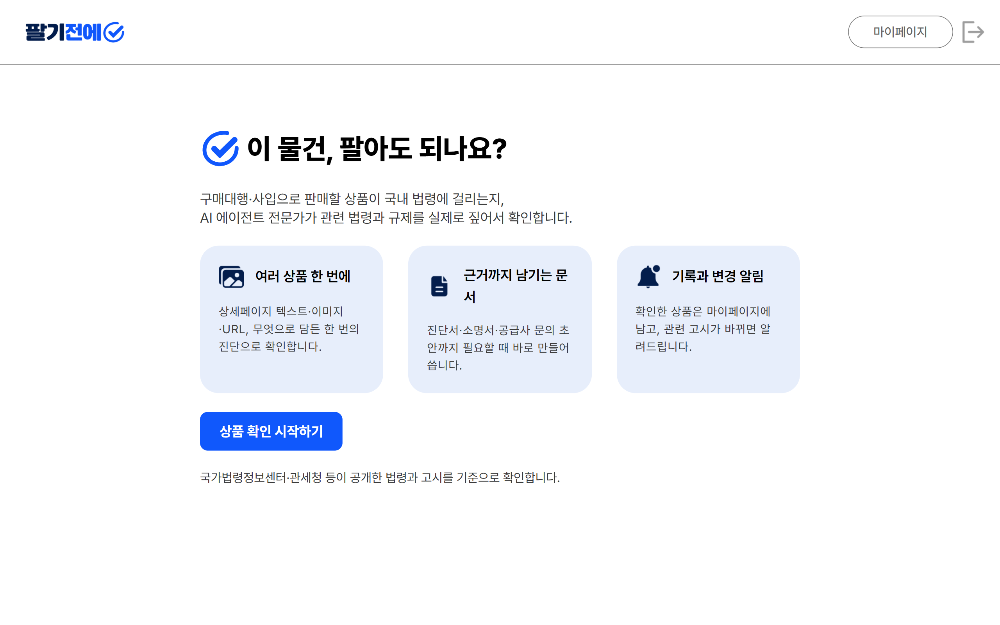
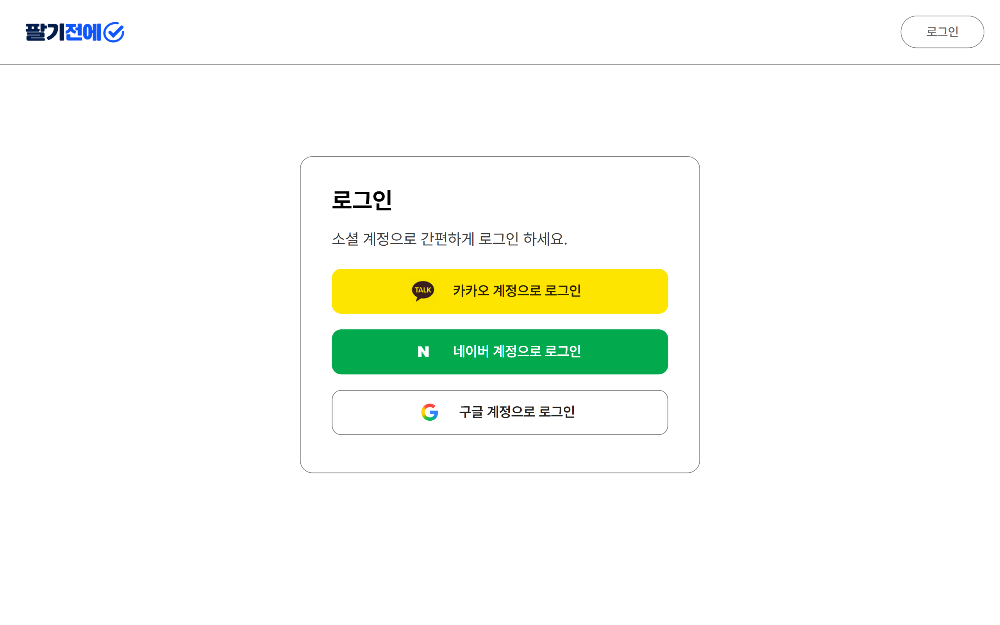
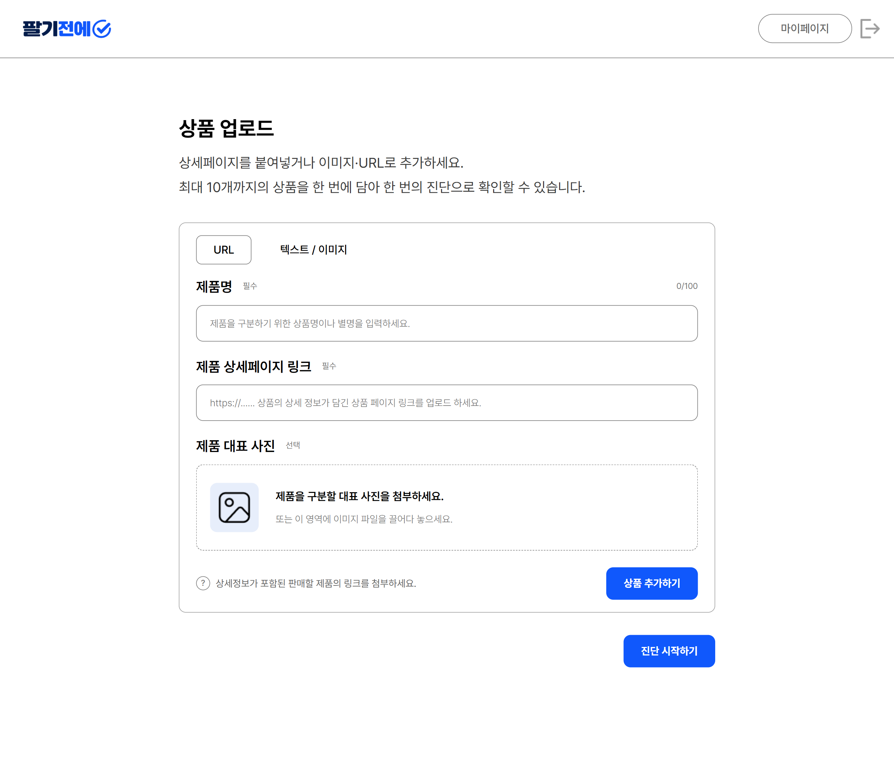
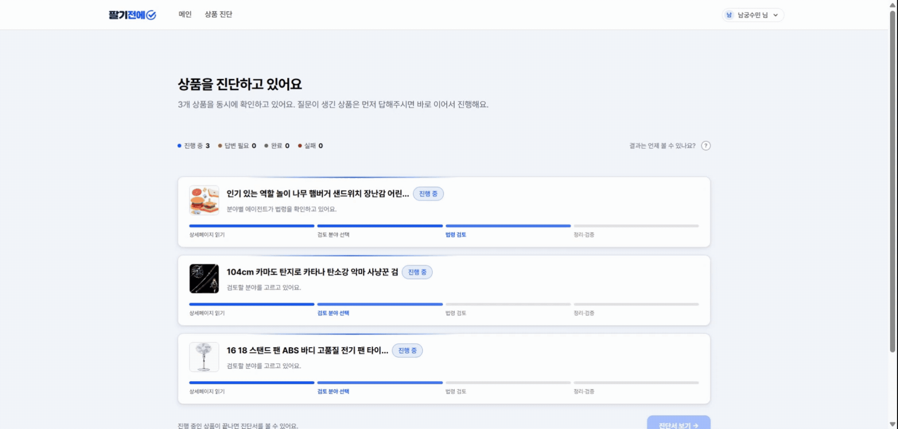
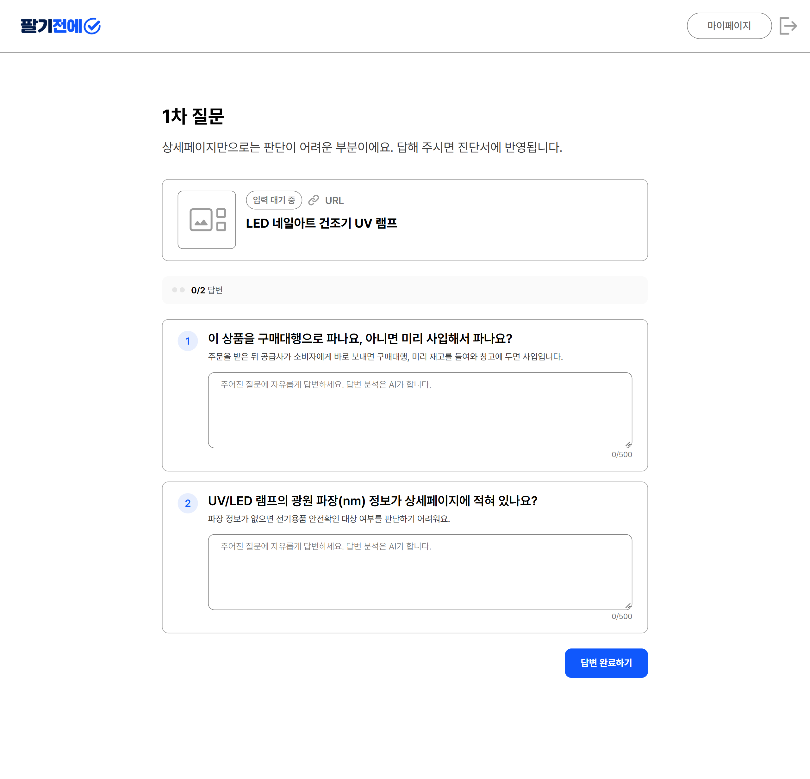
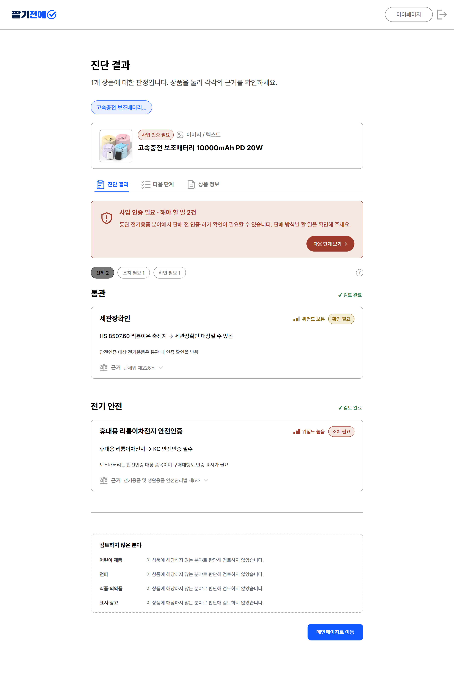
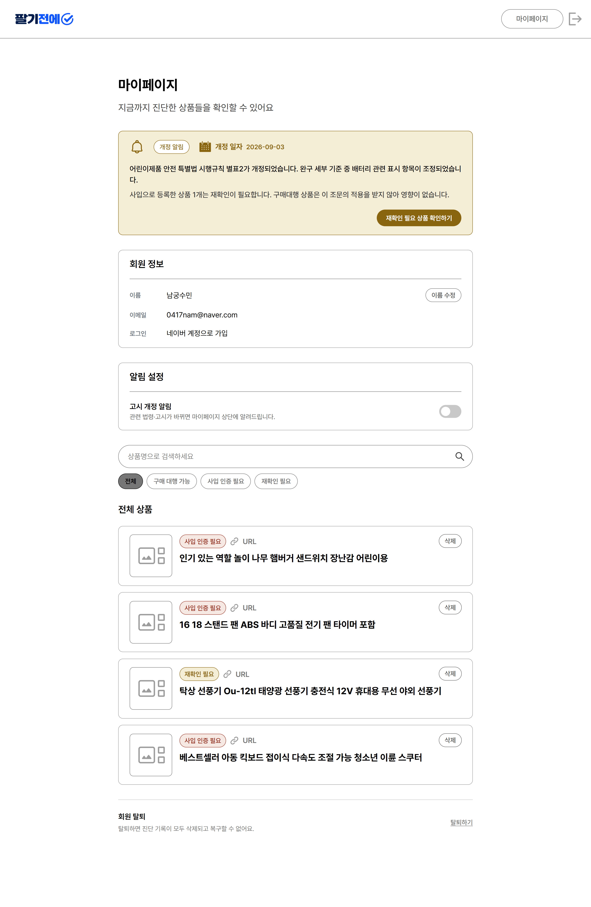
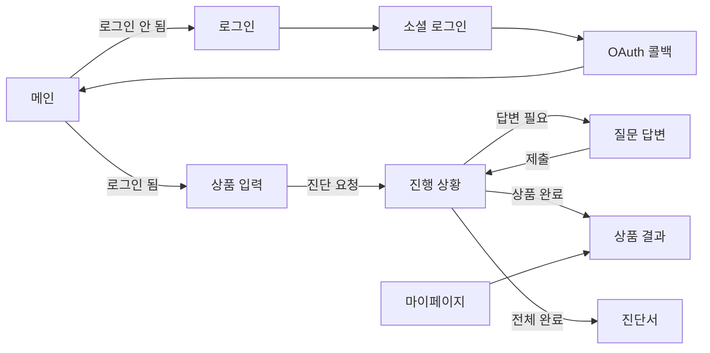

# 팔기전에 FE

상품을 팔기 전 상품 진단을 요청하고, 진행 상황과 해야할 일을 포함한 진단서를 보여주는 프로젝트 입니다.

- 서비스: https://palgijeone.com

## 목차

1. [화면](#화면)
2. [기술 스택](#기술-스택)
3. [디렉터리 구조](#디렉터리-구조)
4. [화면 흐름](#화면-흐름)
5. [로컬 실행](#로컬-실행)
6. [빌드와 배포](#빌드와-배포)
7. [린트와 테스트](#린트와-테스트)
8. [코드 작성 관례](#코드-작성-관례)
9. [알려진 한계](#알려진-한계)

---

## 화면

라우트는 [`src/App.tsx`](palgijeonae/src/App.tsx)에 있습니다.

| 경로 | 화면 | 로그인 필요 |
|---|---|---|
| `/` | 메인. 서비스 소개 | - |
| `/login` | 카카오·네이버·구글 로그인 | - |
| `/oauth/callback` | 로그인 후 토큰을 받아 메인으로 이동 | - |
| `/upload` | 상품 입력(URL 또는 글·이미지, 최대 10개)과 진단 요청 | 필요 |
| `/judgement/:diagnosesId` | 상품별 진단 진행 상황 | 필요 |
| `/question/:productId` | AI 추가 질문에 답변 | 필요 |
| `/result/product/:productId` | 상품 하나의 진단 결과 | 필요 |
| `/result/diagnoses/:diagnosesId` | 진단서 전체 결과 | 필요 |
| `/mypage` | 진단한 상품 목록(검색·필터·페이지), 회원 정보 조회·수정, 상품 삭제, 회원 탈퇴 | 필요 |

- 로그인이 필요한 화면에 로그인하지 않고 들어오면 `/login`으로 보냅니다.

**메인**
- 서비스 소개
- 로그인 여부에 따라 상품 업로드 또는 로그인으로 이동



**로그인**
- 카카오·네이버·구글 소셜 로그인



**상품 업로드**
- URL 또는 텍스트·이미지로 상품 등록
- 최대 10개까지 한 번에 담아 진단 요청



**진단 진행**
- 상품별 진단 진행 상황 확인
- 먼저 끝난 상품은 바로 결과 확인 가능



**질문 답변**
- AI가 판단하기 어려운 부분을 질문
- 답변하면 진단이 이어서 진행



**진단 결과**
- 판정 결과와 근거 법령 확인
- 판매 전 해야 할 일 안내



**마이페이지**
- 진단한 상품 검색·필터·관리
- 회원 정보 조회·수정, 상품 삭제, 회원 탈퇴



## 기술 스택

| 분류 | 사용 기술 |
|---|---|
| 프레임워크 | React 19, TypeScript 6, Vite 8 |
| 라우팅 | React Router 7 |
| 서버 상태 | TanStack Query 5 |
| 클라이언트 상태 | Zustand 5 |
| HTTP | Axios |
| 스타일 | Tailwind CSS 4, class-variance-authority, tailwind-merge, Pretendard 글꼴 |
| 린트 | ESLint 10 (typescript-eslint, react-hooks, import 정렬, 미사용 import 제거) |

Node는 CI와 같은 22를 기준으로 합니다.

## 디렉터리 구조

```
src/
├── api/            # Axios 클라이언트, 도메인별 API 함수, 응답 타입
│   └── mock/       # BE 없이 화면을 볼 때 쓰는 목업 데이터
├── components/
│   ├── common/     # 공용 컴포넌트 (Button, Header, Pagination, HelpTooltip 등)
│   └── layout/     # Header + 본문 레이아웃
├── pages/          # 페이지별 폴더. 페이지 전용 컴포넌트·훅·타입을 같은 폴더에 둠
├── store/          # Zustand 스토어 (인증)
├── constants/      # 상태 배지 라벨
└── lib/            # 유틸 (클래스 병합, 글자 수 계산, 라우트 파라미터 검사)
```

## 화면 흐름



## 로컬 실행

```bash
cd frontend/palgijeonae
npm ci
echo "VITE_API_URL=https://palgijeone.com" > .env.local
npm run dev        # http://localhost:5173
```

- 환경변수는 `VITE_API_URL`(BE 주소) 하나입니다. 보통 배포된 BE를 그대로 바라보고 개발하며, BE를 직접 수정해서 테스트해야 할 때만 [BE 로컬 실행](../backend/README.md#로컬-실행) 후 `http://localhost:8080`으로 바꿉니다.

| 명령 | 내용 |
|---|---|
| `npm run dev` | 개발 서버 |
| `npm run build` | 타입 검사(`tsc -b`) 후 빌드 |
| `npm run lint` | ESLint |
| `npm run preview` | 빌드 결과 미리보기 |

## 빌드와 배포

PR과 develop push 시 [`frontend-ci.yml`](../.github/workflows/frontend-ci.yml)이 `frontend/palgijeonae/` 변경분을 빌드·검사하고, develop에서 CI가 통과하면 [`frontend-deploy.yml`](../.github/workflows/frontend-deploy.yml)이 EC2에 배포합니다.

## 린트와 테스트

- CI는 PR마다 ESLint와 타입 검사를 포함한 빌드를 돌립니다.
- **자동 테스트(단위·E2E)는 아직 없습니다.**

## 코드 작성 관례

FE 코드 컨벤션(네이밍, 폴더·파일 구조, 컴포넌트 작성 규칙, import 순서, API·타입 정의 위치, 상태 관리, 에러 처리, 접근성 등)은 [`CONVENTIONS.md`](CONVENTIONS.md)에 정리했습니다. 브랜치·이슈·PR·커밋 규칙은 루트 [`CONTRIBUTING.md`](../CONTRIBUTING.md)를 참고하세요.

## 알려진 한계

- 자동 테스트가 없습니다.
- 요청 실패와 삭제·탈퇴 확인을 대부분 `alert`/`confirm`으로 처리합니다. 토스트나 커스텀 모달 같은 화면 내 알림은 없습니다.
- 화면 오류를 잡는 ErrorBoundary가 없습니다.
- 요청 타임아웃은 따로 처리하지 않습니다.
- 페이지를 나눠 불러오는 코드 스플리팅을 하지 않습니다.
- 마이페이지의 법령 개정 알림 배너와 알림 설정은 아직 미구현이며, 추후 지원 예정입니다.
