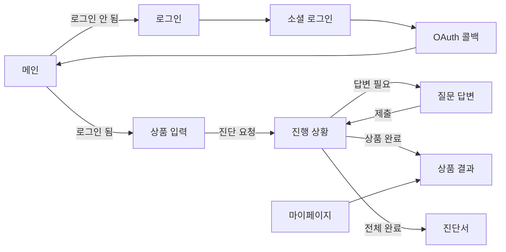

# 팔기전에 FE

상품을 팔기 전 상품 진단을 요청하고, 진행 상황과 해야할 일을 포함한 진단서를 보여주는 프로젝트 입니다.

- 서비스: https://palgijeone.com

## 목차

1. [화면 구성](#화면-구성)
2. [기술 스택](#기술-스택)
3. [디렉터리 구조](#디렉터리-구조)
4. [화면 흐름](#화면-흐름)
5. [상태 관리](#상태-관리)
6. [API 연동](#api-연동)
7. [에러·로딩·빈 상태](#에러로딩빈-상태)
8. [접근성](#접근성)
9. [로컬 실행](#로컬-실행)
10. [빌드와 배포](#빌드와-배포)
11. [린트와 테스트](#린트와-테스트)
12. [코드 작성 관례](#코드-작성-관례)
13. [알려진 한계](#알려진-한계)

---

## 화면 구성

라우트는 [`src/App.tsx`](palgijeonae/src/App.tsx)에 있습니다.

| 경로 | 화면 | 로그인 필요 |
|---|---|---|
| `/` | 메인. 서비스 소개 | - |
| `/login` | 카카오·네이버·구글 로그인 | - |
| `/oauth/callback` | 로그인 후 토큰을 받아 메인으로 이동 | - |
| `/upload` | 상품 입력(URL 또는 글·이미지, 최대 10개)과 진단 요청 | 필요 |
| `/judgement/:diagnosesId` | 상품별 진단 진행 상황 | 필요 |
| `/question/:productId` | AI 추가 질문에 답변 | 필요 |
| `/result/product/:productId` | 상품 하나의 진단 결과 | 필요 |
| `/result/diagnoses/:diagnosesId` | 진단서 전체 결과 | 필요 |
| `/mypage` | 진단한 상품 목록(검색·필터·페이지), 회원 정보 조회·수정, 상품 삭제, 회원 탈퇴 | 필요 |

- 로그인이 필요한 화면에 로그인하지 않고 들어오면 `/login`으로 보냅니다([`ProtectedRoute`](palgijeonae/src/components/common/ProtectedRoute/index.tsx)).

### 화면별 동작

#### 메인


- 로그인 여부에 따라 시작 버튼의 동작이 달라집니다.

#### 로그인


- 카카오·네이버·구글 소셜 로그인을 지원합니다.

#### OAuth 콜백

- 소셜 로그인 후 토큰을 받아 메인으로 돌아오는 중간 화면입니다. 실패하면 로그인 화면으로 돌아갑니다.

#### 상품 업로드


- URL 또는 텍스트·이미지로 최대 10개까지 상품을 담아 한 번에 진단을 요청합니다.

#### 진행 상황


- 진단은 상품마다 1~2분 이상 걸려서, 기다리는 동안 짧은 주기로 상태를 다시 조회하며 진행 상황을 보여줍니다.
- 상품마다 독립적으로 진행되어, 먼저 끝난 상품은 바로 결과를 확인할 수 있습니다.
- 답변이 필요하거나 실패한 상품은 그에 맞는 안내를 보여줍니다.

#### 질문 답변


- 상세페이지만으로 판단하기 어려운 부분은 AI가 질문하고, 답변하면 진단이 이어집니다.

#### 진단 결과


- 진단 결과·다음 단계·상품 정보 탭에서 판정과 근거, 해야 할 일을 확인합니다.

#### 마이페이지


- 진단한 상품을 검색·필터로 찾아보고, 회원 정보 수정·상품 삭제·회원 탈퇴도 여기서 처리합니다.

## 기술 스택

| 분류 | 사용 기술 |
|---|---|
| 프레임워크 | React 19, TypeScript 6, Vite 8 |
| 라우팅 | React Router 7 |
| 서버 상태 | TanStack Query 5 |
| 클라이언트 상태 | Zustand 5 |
| HTTP | Axios |
| 스타일 | Tailwind CSS 4, class-variance-authority, tailwind-merge, Pretendard 글꼴 |
| 린트 | ESLint 10 (typescript-eslint, react-hooks, import 정렬, 미사용 import 제거) |

Node는 CI와 같은 22를 기준으로 합니다.

## 디렉터리 구조

```
src/
├── api/            # Axios 클라이언트, 도메인별 API 함수, 응답 타입
│   └── mock/       # BE 없이 화면을 볼 때 쓰는 목업 데이터
├── components/
│   ├── common/     # 공용 컴포넌트 (Button, Header, Pagination, HelpTooltip 등)
│   └── layout/     # Header + 본문 레이아웃
├── pages/          # 페이지별 폴더. 페이지 전용 컴포넌트·훅·타입을 같은 폴더에 둠
├── store/          # Zustand 스토어 (인증)
├── constants/      # 상태 배지 라벨
└── lib/            # 유틸 (클래스 병합, 글자 수 계산, 라우트 파라미터 검사)
```

## 화면 흐름



상품에 이미지가 있으면 업로드용 URL을 발급받아 S3에 직접 올린 뒤 진단을 요청합니다([`pages/Upload/diagnosisPipeline.ts`](palgijeonae/src/pages/Upload/diagnosisPipeline.ts)).

## 상태 관리

| 종류 | 도구 | 내용 |
|---|---|---|
| 서버 데이터 | TanStack Query | 진행 상황, 질문, 결과, 내 상품 목록, 회원 정보. queryKey는 `[도메인, 식별자]` 형태 |
| 인증 | Zustand ([`useAuthStore`](palgijeonae/src/store/useAuthStore.ts)) | `accessToken`, 로그인 여부, 인증 확인 완료 여부 |

- Access Token은 메모리에만 둡니다. 새로고침하면 사라지므로, 앱이 시작될 때 refresh token 쿠키로 다시 발급받습니다([`App.tsx`](palgijeonae/src/App.tsx)).
- 페이지별 데이터는 각 페이지 폴더의 `use*.ts` 훅에서 가져옵니다.

## API 연동

[`src/api/client.ts`](palgijeonae/src/api/client.ts)의 Axios 인스턴스를 씁니다.

- 로그인 토큰은 요청마다 자동으로 붙이고, 만료되면 자동으로 재발급받아 원래 요청을 이어갑니다. 재발급도 실패하면 로그아웃 후 로그인 화면으로 보냅니다.
- 요청이 너무 잦으면 서버가 알려준 대기 시간에 맞춰 재시도 안내 문구를 보여줍니다.
- BE 에러 메시지는 공통 유틸로 꺼내 보여줍니다. 정확한 처리 방식은 [`CONVENTIONS.md`의 에러 처리](CONVENTIONS.md#에러-처리)를 참고하세요.

## 에러·로딩·빈 상태

| 상태 | 처리 |
|---|---|
| 로딩 | 공용 [`LoadingSpinner`](palgijeonae/src/components/common/LoadingSpinner/index.tsx). 상황별 문구("진단 요청을 보내는 중...", "로그인 처리 중입니다...") |
| 조회 실패 | 페이지마다 안내 문구와 "다시 시도" 버튼 |
| 빈 목록 | "확인할 상품이 없어요.", "조건에 맞는 상품이 없어요." 등 |
| 없는 리소스(404) | 안내 후 메인으로 이동 |
| 잘못된 경로 | 파라미터가 없거나 잘못되면 안내 후 적절한 화면으로 이동 |
| 요청 실패 | `alert`로 BE 에러 문구 표시 |

## 접근성

- 진행 상황이 바뀌면 화면 낭독기가 읽도록 `role="status"` 영역에 알립니다.
- 진행 막대는 순서 목록(`ol`)과 `aria-current="step"`으로 현재 단계를 알리고, 색으로만 구분하던 상태를 텍스트로 보충합니다.
- 탭·토글·툴팁·이미지 확대 창에 맞는 role과 aria 속성을 붙였습니다. 이미지 확대 창은 키보드(←, →, Esc)로 조작할 수 있고, 닫으면 포커스를 원래 위치로 돌려줍니다.
- 버튼을 누를 수 없을 때는 막지 않고 그 이유를 안내합니다.
- `prefers-reduced-motion` 설정이면 애니메이션을 끕니다.
- 장식용 이미지는 `alt=""`로 낭독에서 뺍니다.

## 로컬 실행

```bash
cd frontend/palgijeonae
npm ci
echo "VITE_API_URL=http://localhost:8080" > .env.local
npm run dev        # http://localhost:5173
```

- 환경변수는 `VITE_API_URL`(BE 주소) 하나입니다.
- 로그인까지 하려면 BE를 로컬에서 띄워야 합니다([BE 로컬 실행](../backend/README.md#로컬-실행)). BE 기본 설정이 `http://localhost:5173`을 CORS와 로그인 리다이렉트 주소로 허용합니다.
- Vite 프록시는 쓰지 않습니다. 브라우저가 BE로 직접 요청합니다.

| 명령 | 내용 |
|---|---|
| `npm run dev` | 개발 서버 |
| `npm run build` | 타입 검사(`tsc -b`) 후 빌드 |
| `npm run lint` | ESLint |
| `npm run preview` | 빌드 결과 미리보기 |

## 빌드와 배포

| 워크플로 | 하는 일 |
|---|---|
| [`frontend-ci.yml`](../.github/workflows/frontend-ci.yml) | `frontend/palgijeonae/` 아래가 바뀐 PR과 develop push에서 `npm ci` → lint → build |
| [`frontend-deploy.yml`](../.github/workflows/frontend-deploy.yml) | develop의 CI가 성공하면 빌드 결과를 S3에 올리고, SSM으로 EC2의 릴리스 폴더에 풀어 `current` 링크를 바꿈 |

- 운영에서는 EC2의 nginx가 정적 파일을 서빙합니다. 없는 경로는 `index.html`로 보냅니다(SPA).
- 중간에 실패하면 기존 `current`가 그대로 서비스됩니다.
- 이전 버전으로 되돌리려면 `frontend-deploy.yml`을 수동 실행하면서 이전 커밋 SHA를 넣습니다.
- 운영 `VITE_API_URL`은 GitHub 저장소 변수로 넣습니다.

## 린트와 테스트

- CI는 PR마다 ESLint와 타입 검사를 포함한 빌드를 돌립니다.
- ESLint 규칙: import 자동 정렬, 사용하지 않는 import는 에러로 처리합니다.
- **자동 테스트(단위·E2E)는 아직 없습니다.**

## 코드 작성 관례

FE 코드 컨벤션(네이밍, 폴더·파일 구조, 컴포넌트 작성 규칙, import 순서, API·타입 정의 위치 등)은 [`CONVENTIONS.md`](CONVENTIONS.md)에 정리했습니다. 브랜치·이슈·PR·커밋 규칙은 루트 [`CONTRIBUTING.md`](../CONTRIBUTING.md)를 참고하세요.

## 알려진 한계

- 자동 테스트가 없습니다.
- 요청 실패와 삭제·탈퇴 확인을 대부분 `alert`/`confirm`으로 처리합니다. 토스트나 커스텀 모달 같은 화면 내 알림은 없습니다.
- 화면 오류를 잡는 ErrorBoundary가 없습니다.
- 요청 타임아웃은 따로 처리하지 않습니다.
- 페이지를 나눠 불러오는 코드 스플리팅을 하지 않습니다.
- 마이페이지의 법령 개정 알림 배너와 알림 설정은 화면만 있고 실제 기능은 연결되지 않았습니다.
