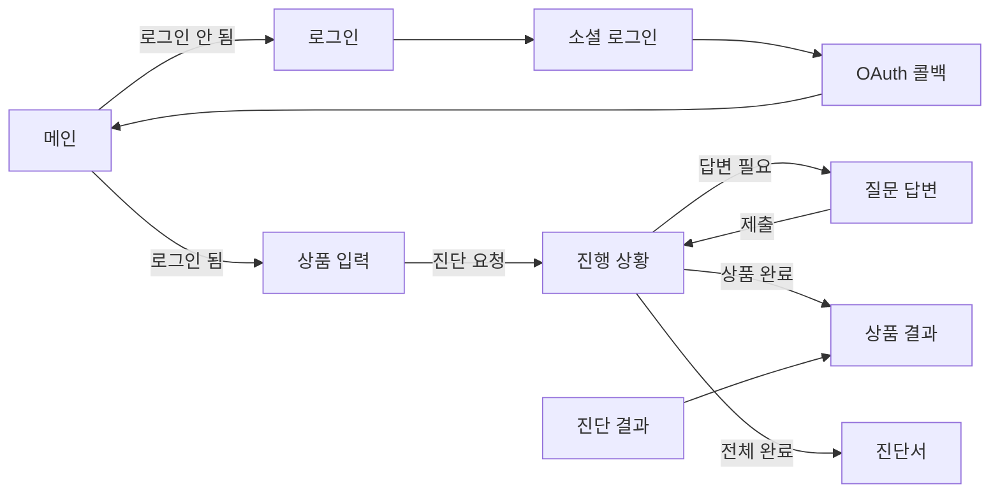

# 팔기전에 FE

- 서비스: https://palgijeone.com

## 목차

1. [화면](#화면)
2. [기술 스택](#기술-스택)
3. [디렉터리 구조](#디렉터리-구조)
4. [로컬 실행](#로컬-실행)
5. [린트와 테스트](#린트와-테스트)
6. [빌드와 배포](#빌드와-배포)
7. [코드 작성 관례](#코드-작성-관례)

---

## 화면

라우트 : [`src/App.tsx`](palgijeonae/src/App.tsx)

| 경로 | 화면 | 로그인 필요 |
|---|---|---|
| `/` | 메인. 서비스 소개 | - |
| `/login` | 카카오·구글 로그인 (네이버는 공개 심사 준비로 화면에서 숨김) | - |
| `/oauth/callback` | 로그인 후 토큰을 받아 메인으로 이동 | - |
| `/upload` | 상품 입력(URL 또는 글·이미지, 최대 10개)과 진단 요청 | 필요 |
| `/judgement/:diagnosesId` | 상품별 진단 진행 상황 | 필요 |
| `/question/:productId` | AI 추가 질문에 답변 | 필요 |
| `/result/product/:productId` | 상품 하나의 진단 결과 | 필요 |
| `/result/diagnoses/:diagnosesId` | 진단서 전체 결과 | 필요 |
| `/products` | 헤더 메뉴의 "진단 결과". 진단한 상품 목록(검색·필터·정렬·페이지), 법령 개정 알림과 재진단, 상품 삭제 | 필요 |
| `/mypage` | 알림 수신 설정, 회원 정보 조회·수정, 회원 탈퇴 | 필요 |
| `/policy/:type` | 이용약관(`terms`), 개인정보처리방침(`privacy`). 탭으로 오가며 푸터와 로그인 화면의 안내 문구 링크로 진입 | - |




화면별 실제 모습은 [루트 README 주요 기능](../README.md#주요-기능)에서 확인할 수 있습니다.

모바일(390px 기준)과 데스크톱을 모두 지원하며 768px(`md`) 미만이 모바일 화면입니다.

## 기술 스택

| 구분 | 주요 기술 |
|---|---|
| FE |          |
| 테스트 |    |
| 인프라 |    |

## 디렉터리 구조

```
src/
├── api/            # BE 리소스별 API 함수 (products, diagnoses, uploads, users, lawAmendments)
│   ├── core/       # Axios 클라이언트, 쿼리 재시도 정책, Sentry 에러 정책, 유효하지 않은 ID·세션 거부 판별
│   ├── types/      # 응답 타입
│   └── mock/       # BE 없이 화면을 볼 때 쓰는 목업 데이터
├── components/
│   ├── common/     # 공용 컴포넌트 (Button, Header, Footer, Pagination, HelpTooltip, 하단 고정 바 BottomActionBar 등)
│   └── layout/     # Header + 본문 레이아웃
├── pages/          # 페이지별 폴더. 페이지 전용 파일을 components/·hooks/·utils/로 나누고, 진입점(index.tsx)·types.ts·constants.ts는 페이지 폴더 바로 아래에 둠
├── store/          # Zustand 스토어 (인증)
├── hooks/          # 공용 훅 (useIsMobile, useEscapeKey, useBodyScrollLock, useFocusTrap, useScrollToTop, useTextFieldFocused)
├── constants/      # 상태 배지 라벨, 헤더·푸터 메뉴, 정책 링크
├── lib/            # 유틸 (클래스 병합, 글자 수 계산, URL·라우트 파라미터 검사, 질문 회차 계산, 이전 화면 경로, JWT 해석)
└── test/           # 단위·통합 테스트, MSW 핸들러, 테스트 유틸
```

문서는 `docs/`에 있습니다: [코드 컨벤션](docs/CODE_CONVENTION.md), [테스트 정책](docs/TEST_POLICY.md).

파트 공통 문서는 [위키](https://github.com/kakaotechcampus-4/ktc4-kangwon-3/wiki)에 있습니다. 아키텍처와 FE ↔ BE 인터페이스 명세는 [테크스펙](https://github.com/kakaotechcampus-4/ktc4-kangwon-3/wiki/테크스펙), 배포 구조는 [CI/CD와 배포](https://github.com/kakaotechcampus-4/ktc4-kangwon-3/wiki/CI-CD와-배포), 장애 대응은 [모니터링과 장애 대응](https://github.com/kakaotechcampus-4/ktc4-kangwon-3/wiki/모니터링과-장애-대응)을 참고하세요.

## 로컬 실행

준비: Node.js 22

```bash
cd frontend/palgijeonae
npm ci
echo "VITE_API_URL=https://palgijeone.com" > .env.local
npm run dev        # http://localhost:5173
```

| 명령 | 내용 |
|---|---|
| `npm run dev` | 개발 서버 |
| `npm run build` | 타입 검사(`tsc -b`) 후 빌드 |
| `npm run lint` | ESLint |
| `npm test` | 단위·통합 테스트 실행 |
| `npm run test:coverage` | 테스트와 커버리지 측정. 구문·분기·함수·줄 중 하나라도 70% 미만이면 실패 |
| `npm run test:watch` | 파일을 저장할 때마다 테스트 다시 실행 |
| `npm run preview` | 빌드 결과 미리보기 |

## 린트와 테스트

```bash
npm run lint
npm run test:coverage
npm run build      # 타입 검사 포함
```

- CI는 PR마다 ESLint, 단위·통합 테스트와 커버리지 기준 검사(70%), 타입 검사를 포함한 빌드를 돌립니다.
- 단위·통합 테스트는 Vitest와 React Testing Library로 작성하고 외부 API는 MSW로 모킹합니다.
- 테스트 종류, 폴더 구조, 작성 규칙, 문제 해결은 [`docs/TEST_POLICY.md`](docs/TEST_POLICY.md)에 정리했습니다.
- E2E 테스트는 [`e2e/`](../e2e/README.md)에 있습니다.

## 빌드와 배포

PR과 develop push 시 [`frontend-ci.yml`](../.github/workflows/frontend-ci.yml)이 `frontend/palgijeonae/` 변경분을 린트·테스트(커버리지 기준 포함)·빌드하고, develop에서 CI가 통과하면 [`frontend-deploy.yml`](../.github/workflows/frontend-deploy.yml)이 EC2에 배포합니다. 테스트가 실패하거나 커버리지가 기준에 못 미치면 CI가 실패하므로 develop에서는 배포되지 않습니다.

## 코드 작성 관례

FE 코드 컨벤션(네이밍, 폴더·파일 구조, 컴포넌트 작성 규칙, import 순서, API·타입 정의 위치, 상태 관리, 에러 처리, 접근성 등)은 [`docs/CODE_CONVENTION.md`](docs/CODE_CONVENTION.md)에 정리했습니다. 브랜치·이슈·PR·커밋 규칙은 루트 [`CONTRIBUTING.md`](../CONTRIBUTING.md)를 참고하세요.
